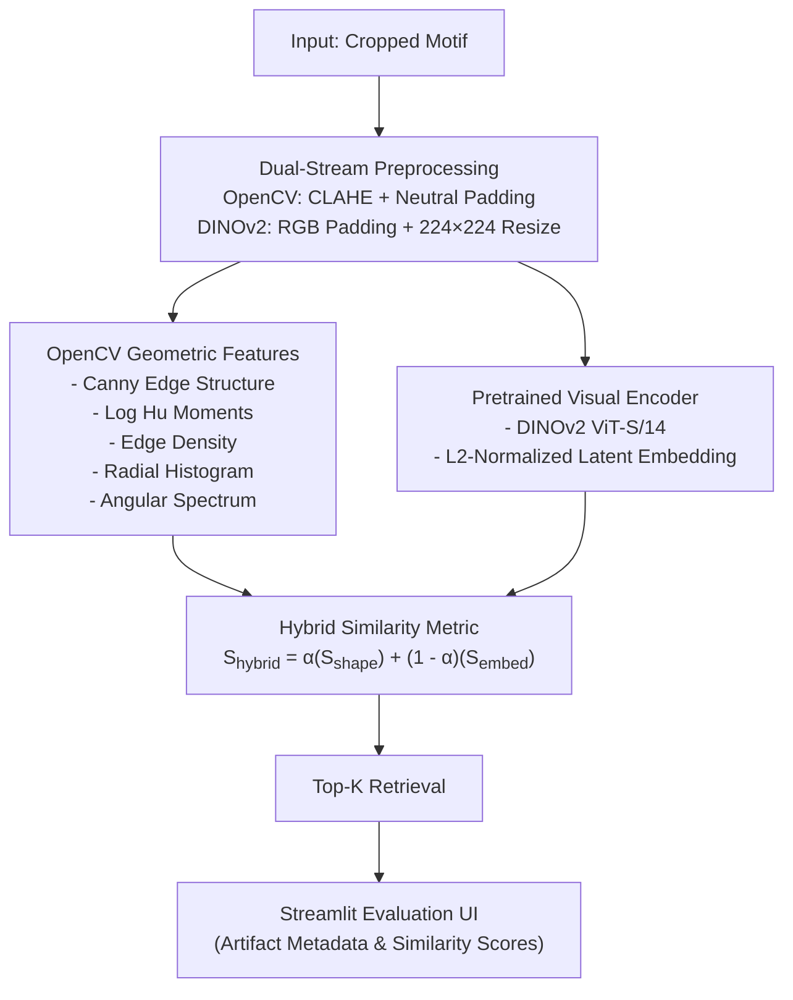

<h1>
  
  Symbolic Detective
</h1>


### v0.1 — Unknown Motif Finder

[](LICENSE)
[](https://www.python.org/)
[]()

**Symbolic Detective** is an open-source computational iconography project for discovering, comparing, and contextualizing visual motifs across cultural heritage collections. 

Version `0.1` deliberately isolates the core computer vision and similarity retrieval problem: **given a cropped unknown motif from a historical artifact, can the system reliably retrieve visually related occurrences from a multi-material cultural heritage collection?**

All higher-level reasoning layers (LLM-based explanation, knowledge graphs, automatic detection, and migration claims) are intentionally deferred. v0.1 evaluates visual retrieval alone.


## The Core Premise: Investigation Over Assumption

A central methodological risk in computational iconography is treating visual similarity as evidence of historical transmission or shared symbolic identity. Symbolic Detective operates under an explicit investigative framework:

$$\text{Visual Resemblance} \not\equiv \text{Shared Symbol} \not\equiv \text{Historical Transmission} \not\equiv \text{Identical Meaning}$$

v0.1 provides the empirical visual baseline needed to answer two inverse questions in future releases:
1. **Visual homoplasy** (working term): visually similar motifs that arise independently or represent different symbolic identities.
2. **Symbolic allomorphy** (working term): visually different forms that share a historically supported symbolic identity.


## Featured Investigation: Case 001 — The Eight-Pointed Star

The primary test case for v0.1 is the **Eight-Pointed Star**:
* **Challenge:** Eight-pointed geometries appear across ancient Mesopotamian glyptic art, Babylonian kudurrus, Roman mosaics, Islamic architectural tilework, and modern emblems.
* **Objective:** Determine whether an ensemble of interpretable geometric descriptors and deep visual embeddings can retrieve related eight-pointed motifs across radically different substrates (weathered stone, glazed ceramic, seal impressions, bronze) while discriminating them from hard negative controls (five-pointed stars, rosettes) and generic negative controls (geometric cross-hatching).


## Pipeline Architecture



1. **Manual Crop**: Isolated motif input from an open-access museum artifact.
2. **Normalization:** CLAHE enhancement and neutral padding for the OpenCV stream; aspect-ratio-preserving square padding and 224×224 resizing for DINOv2.
3. **Dual-Feature Extraction**:
   * **Geometric Features:** OpenCV extracts edge-based geometry using Canny edges, log-transformed Hu moments, edge density, radial distribution, and a rotation-invariant angular Fourier spectrum.
   * **Dense Latent Embeddings:** DINOv2 ViT-S/14 generates an L2-normalized learned visual representation using inference only.
4. **Hybrid Scoring**: Convert shape distance and embedding similarity into normalized similarity scores, then combine them using a weighted linear ensemble ($S_{shape} \in [0, 1]$, $S_{embed} \in [0, 1]$). 
5. **Top-K Retrieval**: Ranked search over a persisted local feature index. The index is automatically rebuilt when the motif corpus or feature configuration changes.


## 📂 Project Structure

```text
symbolic-detective/
├── data/
│   ├── raw/                      # Downloaded open-access images
│   ├── crops/                    # Curated motif crops (only CC0 subset)
│   │   ├── eight_pointed_star/   # Case 001 target family
│   │   ├── rosette/              # Hard negative / related radial motif
│   │   ├── five_pointed_star/    # Hard negative / related star geometry
│   │   ├── six_pointed_star/     # Hard negative / related star geometry
│   │   ├── negative_control/     # Other geometric motifs
│   │   └── crops.json            # Crops ids, original ids, size
│   ├── metadata.json             # Provenance, period, material, museum IDs
│   └── index.npz                 # Generated local feature index (not committed)
├── scripts/
│   ├── data_stats.py             # Data statistics
│   └── stage_licensed_images.py  # Script for staging images with permitted license
├── src/
│   └── symbolic_detective/
│       ├── ingestion/            # Museum API harvesters (The Met, Europeana)
│       │   ├── met_api.py        # /public/collection/v1.1/search client
│       │   └── europeana_api.py  # Europeana REST client
│       ├── pipeline/
│       │   ├── preprocess.py     # Image normalization routines
│       │   ├── shape_features.py # OpenCV edge-based geometric feature extraction
│       │   ├── embeddings.py     # Latent feature generation
│       │   └── hybrid_search.py  # Similarity computation and ranking
│       ├── utils/
│       │   ├── image_crop.py     # Script for fast image cropping
│       │   └── image_files.py    
│       └── evaluate.py           # Benchmark script: Hit@K and MRR
├── ui/
│   └── app.py                    # Streamlit exploration dashboard
├── tests/                        # Unit tests for feature extraction
├── .gitignore
├── pyproject.toml
├── requirements-lock.txt
├── LICENSE
└── README.md
```


## 📊 Benchmark & Evaluation

v0.1 treats motif-family labels strictly as evaluation ground truth; they are
never passed to the retrieval algorithms. Artifact metadata is retained for
provenance and analysis but is not used as input to the v0.1 similarity ranking.

### v0.1 Experimental Setup & Results

- **Methodology:** 5-Fold Artifact-Grouped Cross-Validation
- **Dataset:** 127 manually verified motif crops (98 valid distinct artifacts)
- **Queries Evaluated:** 107 total, including 60 `eight_pointed_star` queries

For the primary Eight-Pointed Star retrieval task, the best-performing tested
hybrid configuration (**α = 0.25**) improves over DINOv2 alone, achieving
**Hit@1 = 0.877 ± 0.121** and **MRR = 0.925 ± 0.073**. DINOv2 remains the
strongest method for overall multi-class retrieval.

👉 **[View the full v0.1 5-Fold Cross-Validation Report](results/v0.1_evaluation.md)**
for complete target-level and multi-class results across the alpha sweep.

**Robustness Stress Tests** (to be updated)

Retrieval performance is benchmarked against synthetic corruptions approximating common challenges in digitized archaeological and cultural-heritage imagery:
 * Arbitrary rotation (0° to 360°).
 * Illumination and contrast degradation.
 * Blur and morphological corruption approximating surface degradation.
 * Partial occlusion / masking.


## Getting Started

### 1. Installation
#### Prerequisites
* Python 3.12+
* [uv](https://docs.astral.sh/uv/getting-started/installation/)
* Europeana API Key ([Get an API key](https://pro.europeana.eu/page/get-api))

```bash
git clone https://github.com/AetherMarina/symbolic-detective.git
cd symbolic-detective
export EUROPEANA_API_KEY="your_api_key"
uv venv
source .venv/bin/activate
uv pip sync requirements-lock.txt
# uv pip compile pyproject.toml --extra test -o requirements-lock.txt
uv pip install -e .
```

### 2. Candidate Ingestion
Harvest candidate artifacts from The Metropolitan Museum of Art Open Access API (using the paginated v1.1 endpoint):
```bash
python -m symbolic_detective.ingestion.met_api --query "star" --department 33 --limit 2
```
Harvest candidate artifacts from The Metropolitan Museum of Art Open Access API (using the paginated v1.1 endpoint):
```bash
python -m symbolic_detective.ingestion.europeana_api --query "star" --limit 2
```

### 3. Run Benchmark Evaluation
Compare the OpenCV, DINOv2, and hybrid retrieval baselines on the held-out query set:
```bash
python -m symbolic_detective.evaluate --data-dir data/crops/
```

### 4. Launch the Exploration UI
```bash
streamlit run ui/app.py
```
The Streamlit dashboard allows you to upload an arbitrary motif crop, inspect its extracted edge representation, and examine the top retrieved artifacts alongside similarity scores, artifact metadata, and source provenance.

### Cached Feature Index

Symbolic Detective caches OpenCV geometric features, DINOv2 embeddings and  corpus-level standardization statistics in `data/index.npz`.

The cache is validated against the current motif corpus and feature/model configuration. If images are added, removed, or modified—or the feature schema changes—the index is rebuilt automatically.

## Developer Utilities

If you are modifying the feature extraction logic, you can test individual components of the pipeline on a single cropped motif.
Replace the path below with a valid crop from your `data/crops/` directory:

```bash
# 1. Test OpenCV normalization (CLAHE + Padding)
python -m symbolic_detective.pipeline.preprocess data/crops/eight_pointed/YOUR_IMAGE.jpg

# 2. Extract interpretable geometric features and save an edge debug image
python -m symbolic_detective.pipeline.shape_features data/crops/eight_pointed/YOUR_IMAGE.jpg

# 3. Extract the DINOv2 dense latent representation
python -m symbolic_detective.pipeline.embeddings data/crops/eight_pointed/YOUR_IMAGE.jpg

# 4. Build the local motif index and retrieve the Top-K matches
python -m symbolic_detective.pipeline.hybrid_search data/crops/eight_pointed/IMAGE_1.jpg 0.5
```

## Roadmap

### v0.1 — Unknown Motif Finder
* [x] Curate initial motif corpus from Met
* [x] Implement preprocessing
* [x] Implement OpenCV baseline
* [x] Implement DINOv2 embedding baseline
* [x] Implement hybrid retrieval
* [x] Build held-out evaluation set
* [x] Build Streamlit explorer
* [x] Europeana REST client
* [x] 100-150 motifs
* [x] Publish Case 001 results
* [ ] Run robustness experiments


## Future Horizons

* **v0.2 — Related Motif Discrimination:** Granular separation of overlapping geometries.
* **v0.3 — Contextual Identity:** Investigating whether visually different motif forms can share a historically supported symbolic identity.
* **v0.4 — Automatic Detection:** Full artifact → bounding-box localization via fine-tuned models.
* **v0.5 — Unknown Motif Memory:** Unsupervised clustering of recurring, undocumented motifs.
* **v0.6 — Spatiotemporal Graph:** Knowledge graph layer connecting motifs, places, periods, materials, and documented relationships.
* **v0.7 — Evidence & Local RAG:** Grounded synthesis of scholarly sources using local LLMs.
* **v1.0 — Symbolic Detective:** Full-stack computational iconography engine.

## License

This project is licensed under the Apache License 2.0 — see the LICENSE file for details. Third-party cultural heritage images and metadata remain subject to the rights and reuse terms specified by their respective source institutions. Source attribution and licensing information are retained in the dataset metadata.