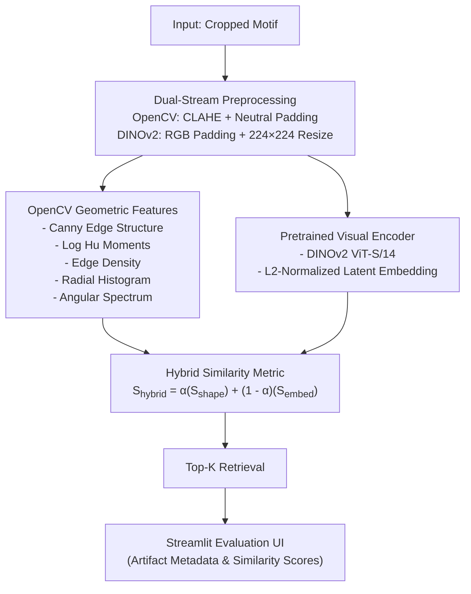

<h1>
  
  Symbolic Detective
</h1>


[](LICENSE)
[](https://www.python.org/)
[]()

**Symbolic Detective** is an open-source computational iconography project for discovering, comparing, and contextualizing visual motifs across cultural heritage collections. 

Version `0.1` deliberately isolates the core computer vision and similarity retrieval problem: **given a cropped unknown motif from a historical artifact, can the system reliably retrieve visually related occurrences from a multi-material cultural heritage collection?**

All higher-level reasoning layers (LLM-based explanation, knowledge graphs, automatic detection, and migration claims) are intentionally deferred. v0.1 evaluates visual retrieval alone.


## The Core Premise: Investigation Over Assumption

A central methodological risk in computational iconography is treating visual similarity as evidence of historical transmission or shared symbolic identity. Symbolic Detective operates under an explicit investigative framework:

$$\text{Visual Resemblance} \not\equiv \text{Shared Symbol} \not\equiv \text{Historical Transmission} \not\equiv \text{Identical Meaning}$$

v0.1 provides the empirical visual baseline needed to answer two inverse questions in future releases:
1. **Visual homoplasy** (working term): visually similar motifs that arise independently or represent different symbolic identities.
2. **Symbolic allomorphy** (working term): visually different forms that share a historically supported symbolic identity.


## Featured Investigation: Case 001 — The Eight-Pointed Star

The primary test case for v0.1 is the **Eight-Pointed Star**:
* **Challenge:** Eight-pointed geometries appear across ancient Mesopotamian glyptic art, Babylonian kudurrus, Roman mosaics, Islamic architectural tilework, and modern emblems.
* **Objective:** Determine whether an ensemble of interpretable geometric descriptors and deep visual embeddings can retrieve related eight-pointed motifs across radically different substrates (weathered stone, glazed ceramic, seal impressions, bronze) while discriminating them from hard negative controls (five-pointed stars, rosettes) and generic negative controls (geometric cross-hatching).


## Pipeline Architecture



1. **Manual Crop**: Isolated motif input from an open-access museum artifact.
2. **Normalization:** CLAHE enhancement and neutral padding for the OpenCV stream; aspect-ratio-preserving square padding and 224×224 resizing for DINOv2.
3. **Dual-Feature Extraction**:
   * **Geometric Features:** OpenCV extracts edge-based geometry using Canny edges, log-transformed Hu moments, edge density, radial distribution, and a rotation-invariant angular Fourier spectrum.
   * **Dense Latent Embeddings:** DINOv2 ViT-S/14 generates an L2-normalized learned visual representation using inference only.
4. **Hybrid Scoring**: Convert shape distance and embedding similarity into normalized similarity scores, then combine them using a weighted linear ensemble ($S_{shape} \in [0, 1]$, $S_{embed} \in [0, 1]$). 
5. **Top-K Retrieval**: Ranked search over a persisted local feature index. The index is automatically rebuilt when the motif corpus or feature configuration changes.


## 📂 Project Structure
<details>
<summary>Expand project structure</summary>

```text
symbolic-detective/
├── data/
│   ├── raw/                         # Downloaded open-access images
│   ├── crops/                       # Curated motif crops
│   │   ├── eight_petal_rosette/
│   │   ├── eight_pointed_star/
│   │   ├── five_pointed_star/
│   │   ├── negative_control/
│   │   ├── rosette_other/
│   │   ├── six_pointed_star/
│   │   ├── sunburst/
│   │   ├── unclassified/            # Excluded from evaluation
│   │   └── crops.json               # Crop metadata and source references
│   ├── splits/
│   │   └── v0.2_split.json          # Artifact-grouped 80/20 dev/test split
│   ├── metadata.json                # Provenance, period, material, museum IDs
│   └── index.npz                    # Generated local feature index (not committed)
│
├── notebooks/
│   ├── v0.2_class_voting_analysis.ipynb
│   └── v0.2_geometry_ablation_analysis.ipynb
│
├── results/
│   ├── v0.1/                        # Frozen v0.1 evaluation
│   │   ├── evaluation.md
│   │   ├── error_analysis.json
│   │   └── figures/
│   │
│   ├── v0.2_baseline/               # Initial baseline on v0.1 dataset
│   │   ├── evaluation.md
│   │   ├── error_analysis.json
│   │   └── figures/
│   │
│   ├──  v0.2_dev_baseline/          # Expanded v0.2 dataset, initial representation
│   │   ├── evaluation.md
│   │   ├── retrieval_metrics.json
│   │   ├── error_analysis.json
│   │   ├── voting_evaluation.md
│   │   ├── class_voting.json
│   │   ├── voting_error_analysis.json
│   │   └── figures/
│   │
│   └── v0.2_dev/                    # Feature-improvement experiments
│       ├── exp01_harmonics/
│       ├── exp02_peaks/
│       ├── exp03_pointedness/
│       ├── exp04_radius/
│       ├── exp05_central_structure/
│       └── phase_b_combinations/
│
├── scripts/
│   ├── compare_phase_b.py           # Compare phase_b metrics
│   ├── create_split.py              # Stratified artifact-grouped splitting
│   ├── data_stats.py                # Dataset and crop statistics
│   ├── crops_update.py              # Crop class reassignment
│   ├── plot_evaluation.py           # Benchmark visualizations
│   ├── list_restricted_images.py    # Image redistribution checks
│   └── run_experiments.py           # CLI entry point
│
├── src/
│   └── symbolic_detective/
│       ├── ingestion/               # Museum API harvesters
│       │   ├── met_api.py           # Met client
│       │   ├── europeana_api.py     # Europeana REST API
│       │   └── cleveland_api.py     # Cleveland Museum of Art API
│       ├── pipeline/
│       │   ├── preprocess.py        # Image normalization
│       │   ├── shape_features.py    # OpenCV geometric descriptors
│       │   ├── embeddings.py        # DINOv2 embeddings
│       │   ├── hybrid_search.py     # Similarity scoring and retrieval
│       │   └── class_voting.py      # Top-1, majority, weighted voting
│       ├── utils/
│       │   ├── image_crop.py        # Manual motif cropping utility
│       │   └── image_files.py       # Image discovery and collection
│       ├── experiment_configs.py
│       ├── evaluation_metrics.py    # Hit@K, MRR, confusion matrix
│       ├── evaluate.py              # Stratified artifact-grouped retrieval benchmark
│       └── evaluate_robustness.py   # Synthetic degradation experiments
│
├── ui/
│   └── app.py                       # Streamlit exploration dashboard
│
├── tests/                           # Automated unit tests
│
├── .github/
│   └── workflows/
│       └── tests.yml                # Continuous integration
│
├── .gitignore
├── pyproject.toml
├── requirements-lock.txt
├── LICENSE
└── README.md
```

</details>

## 📊 Benchmark & Evaluation

v0.1 treats motif-family labels strictly as evaluation ground truth; they are never passed to the retrieval algorithms. Artifact metadata is retained for provenance and analysis but is not used in the v0.1 similarity ranking.

### v0.1 Experimental Setup & Results

- **Methodology:** 5-Fold Artifact-Grouped Cross-Validation
- **Dataset:** 127 manually verified motif crops (98 valid distinct artifacts)
- **Queries Evaluated:** 107 total, including 60 `eight_pointed_star` queries
- **Methods:** OpenCV geometric features, DINOv2 embeddings, and weighted hybrid retrieval
- **Metrics:** Hit@1, Hit@5, Mean Reciprocal Rank (MRR)

For Eight-Pointed Star retrieval, the best-performing tested hybrid
configuration (**α = 0.25**) achieves:

- **Hit@1:** 0.877 ± 0.121 (DINOv2: 0.857 ± 0.074)
- **Hit@5:** 0.985 ± 0.031
- **MRR:** 0.925 ± 0.073 (DINOv2: 0.911 ± 0.050)

DINOv2 remains the strongest baseline for overall multi-class retrieval
(Hit@1: 0.760 vs. 0.708 for the hybrid).

Per-query analysis shows that geometric features correct four DINOv2
retrieval errors while introducing three new errors. The net improvement
is modest and does not establish statistically significant superiority.

### Robustness Under Synthetic Degradation

We evaluated DINOv2 (α=0.0) and Hybrid (α=0.25) against synthetic
image degradations using clean reference images and corrupted queries.

Test conditions include:

- Fixed 90° rotation
- Gaussian blur (5×5 and 11×11)
- Reduced brightness and contrast
- Approximately 10% random occlusion


**Figure 2.** Hit@1 retrieval accuracy across synthetic degradations.
Bars represent mean performance across five artifact-grouped folds.
Standard deviations are reported in the full evaluation report.

**Key observations:**

- **Rotation:** Hybrid Hit@1 remains nearly unchanged (0.877 → 0.876).
- **Moderate blur:** Hybrid Hit@1 increases slightly to 0.903 under 5×5 Gaussian blur.
- **Severe blur:** Both methods degrade, with the hybrid dropping to 0.774 under 11×11 blur.
- **Lighting and contrast:** Both methods improve under reduced brightness (Hybrid Hit@1: 0.877 → 0.902), while reduced contrast causes a modest decline in hybrid performance (0.877 → 0.855).
- **Partial occlusion:** Hybrid Hit@1 remains close to its clean baseline (0.881).
- **Feature reliability:** Severe blur caused one OpenCV geometric feature-extraction failure. The affected query was counted as an unsuccessful hybrid retrieval (Hit@1 = 0, Hit@5 = 0, MRR = 0), rather than excluded, to avoid survivorship bias. DINOv2 retrieval was evaluated independently.

These findings suggest that geometric features can provide complementary robustness under certain transformations, but their contribution is condition-dependent.

Results are exploratory and limited to the evaluated dataset and synthetic degradation settings.

### Full Evaluation Report

👉 **[v0.1 Benchmark, Error Analysis & Robustness Evaluation](results/v0.1/evaluation.md)**

The report contains the complete alpha sweep, per-query error analysis, robustness metrics (Hit@1, Hit@5, MRR), experimental methodology and limitations.


## Getting Started

### 1. Installation
#### Prerequisites
* Python 3.12+
* [uv](https://docs.astral.sh/uv/getting-started/installation/)
* Europeana API Key ([Get an API key](https://pro.europeana.eu/page/get-api))

```bash
git clone https://github.com/AetherMarina/symbolic-detective.git
cd symbolic-detective
export EUROPEANA_API_KEY="your_api_key"
uv venv
source .venv/bin/activate
uv pip sync requirements-lock.txt
# uv pip compile pyproject.toml --extra test -o requirements-lock.txt
uv pip install -e .
```

### 2. Candidate Ingestion
Harvest candidate artifacts from The Metropolitan Museum of Art Open Access API (using the paginated v1.1 endpoint):
```bash
python -m symbolic_detective.ingestion.met_api --query "star" --department 33 --limit 2
```
Harvest candidate artifacts from Europeana REST API:
```bash
python -m symbolic_detective.ingestion.europeana_api --query "star" --limit 2
```

### 3. Run Benchmark Evaluation

Evaluate DINOv2, OpenCV, and hybrid retrieval using artifact-grouped 5-fold cross-validation on the **v0.2 development split**. The held-out test set remains reserved for final evaluation.

```bash
# Original v0.2 baseline
python scripts/run_experiments.py --experiment baseline --mode all

# Individual geometric feature ablation
python scripts/run_experiments.py --experiment exp01_harmonics --mode all

# Run all registered ablation experiments
python scripts/run_experiments.py --all --mode all

# Robustness evaluation
python -m symbolic_detective.evaluate_robustness --data-dir data/crops/
```

Results are saved under `results/v0.2_dev_baseline/` and `results/v0.2_dev/<experiment_name>/`.
For methodology details, see [Evaluation Protocol](docs/research/evaluation_protocol.md).

### 4. Launch the Exploration UI
```bash
streamlit run ui/app.py
```
The Streamlit dashboard allows you to upload an arbitrary motif crop, inspect its extracted edge representation, and examine the top retrieved artifacts alongside similarity scores, artifact metadata, and source provenance.

### Cached Feature Index

Symbolic Detective caches OpenCV geometric features, DINOv2 embeddings and  corpus-level standardization statistics in `data/index.npz`.

The cache is validated against the current motif corpus and feature/model configuration. If images are added, removed, or modified—or the feature schema changes—the index is rebuilt automatically.

## Developer Utilities

If you are modifying the feature extraction logic, you can test individual components of the pipeline on a single cropped motif.
Replace the path below with a valid crop from your `data/crops/` directory:

```bash
# 1. Test OpenCV normalization (CLAHE + Padding)
python -m symbolic_detective.pipeline.preprocess data/crops/eight_pointed/YOUR_IMAGE.jpg

# 2. Extract interpretable geometric features and save an edge debug image
python -m symbolic_detective.pipeline.shape_features data/crops/eight_pointed/YOUR_IMAGE.jpg

# 3. Extract the DINOv2 dense latent representation
python -m symbolic_detective.pipeline.embeddings data/crops/eight_pointed/YOUR_IMAGE.jpg

# 4. Build the local motif index and retrieve the Top-K matches
python -m symbolic_detective.pipeline.hybrid_search data/crops/eight_pointed/IMAGE_1.jpg 0.5
```

## Roadmap

### v0.1 — Unknown Motif Finder ✅ Completed
- Visual similarity retrieval using DINOv2 and OpenCV
- Hybrid retrieval with artifact-grouped 5-fold cross-validation
- Streamlit exploration interface
- Robustness evaluation and published benchmark results

### v0.2 — Related Motif Discrimination 🚧 In Progress
- [x] Establish baseline confusion matrices on the v0.1 dataset
- [x] Expand and rebalance related motif classes
- [x] Establish artifact-grouped development/test split
- [x] Evaluate fine-grained discrimination across related motifs on the development set
- [x] Analyze incorrect top-1 retrievals and class confusion on the development set
- [x] Investigate improved geometric representations (harmonics, peaks, pointedness, radius)
- [x] Select and freeze the final configuration using development-set results
- [ ] Run final evaluation on the untouched held-out test set
- [ ] Evaluate negative-query rejection
- [ ] Extend the Streamlit UI to visualize motif discrimination, comparing top-ranked candidates, geometric feature differences, and similarity-score contributions to explain why one motif class is preferred over another.
- [ ] Publish v0.2 evaluation results

## Future Horizons

* **v0.3 — Contextual Identity:** Investigating whether visually different motif forms can share a historically supported symbolic identity.
* **v0.4 — Automatic Detection:** Full artifact → bounding-box localization via fine-tuned models.
* **v0.5 — Unknown Motif Memory:** Unsupervised clustering of recurring, undocumented motifs.
* **v0.6 — Spatiotemporal Graph:** Knowledge graph layer connecting motifs, places, periods, materials, and documented relationships.
* **v0.7 — Evidence & Local RAG:** Grounded synthesis of scholarly sources using local LLMs.
* **v1.0 — Symbolic Detective:** Full-stack computational iconography engine.

## License

This project is licensed under the Apache License 2.0 — see the LICENSE file for details. Third-party cultural heritage images and metadata remain subject to the rights and reuse terms specified by their respective source institutions. Source attribution and licensing information are retained in the dataset metadata.