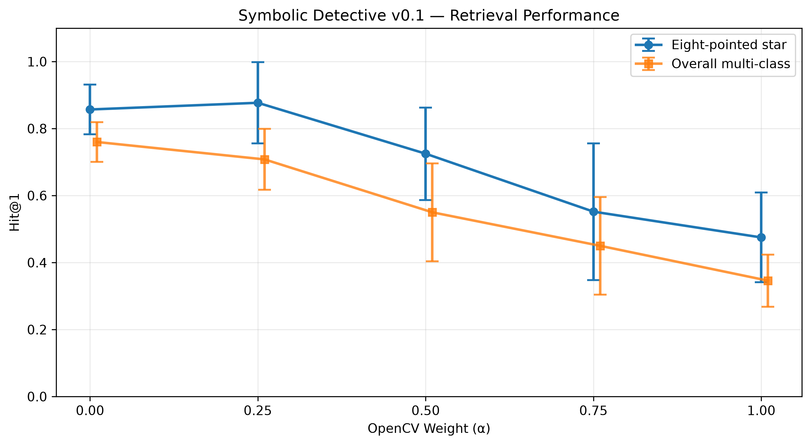
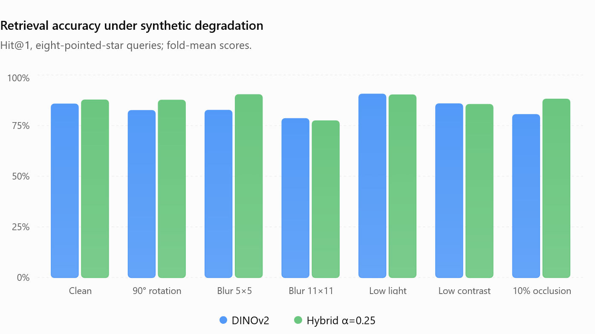

## v0.1 Benchmark: Eight-Pointed Star Retrieval

**Methodology:** 5-Fold Artifact-Grouped Cross-Validation
**Dataset:** 127 total crops (98 valid distinct artifacts)
**Queries Evaluated:** 107 (60 Target `eight_pointed_star`)

Our v0.1 benchmark demonstrates that while deep latent embeddings (DINOv2) provide a strong baseline for general multi-class retrieval, a **hybrid ensemble (Alpha 0.25) leveraging OpenCV geometric features** yields superior Hit@1 and Mean Reciprocal Rank (MRR) for our primary target, the Eight-Pointed Star.

### Target: Eight-Pointed Star (60 queries)
|         **Method**         | Alpha |      Hit@1      | Hit@5         |       MRR       |
|----------------------------|-------|-----------------|---------------|-----------------|
| Latent Embeddings (DINOv2) | 0.00  | 0.857 ± 0.074 | 0.985 ± 0.031 | 0.911 ± 0.050 |
| Hybrid Ensemble (Optimal)  | 0.25  | **0.877 ± 0.121** | **0.985 ± 0.031** | **0.925 ± 0.073** |
| Hybrid Ensemble            | 0.50  | 0.725 ± 0.138 | 0.986 ± 0.029 | 0.853 ± 0.079 |
| Hybrid Ensemble            | 0.75  | 0.552 ± 0.204 | 0.986 ± 0.029 | 0.757 ± 0.113 |
| OpenCV Geometric Features  | 1.00  | 0.475 ± 0.134 | 0.952 ± 0.066 | 0.673 ± 0.080 |

### Overall Multi-Class (107 queries)
|         **Method**         | Alpha |      Hit@1      |      Hit@5      |       MRR       |
|----------------------------|-------|-----------------|-----------------|-----------------|
| Latent Embeddings (DINOv2) | 0.00  | **0.760 ± 0.059** | **0.881 ± 0.054** | **0.813 ± 0.044** |
| Hybrid Ensemble            | 0.25  | 0.708 ± 0.091 | 0.871 ± 0.054 | 0.784 ± 0.048 |
| Hybrid Ensemble            | 0.50  | 0.550 ± 0.146 | 0.872 ± 0.044 | 0.708 ± 0.081 |
| Hybrid Ensemble            | 0.75  | 0.450 ± 0.146 | 0.870 ± 0.028 | 0.637 ± 0.081 |
| OpenCV Geometric Features  | 1.00  | 0.346 ± 0.078 | 0.805 ± 0.069 | 0.549 ± 0.059 |

### Retrieval Performance vs. OpenCV Weight

**Figure 1.** Hit@1 retrieval performance across OpenCV geometric-feature weights (α), evaluated using artifact-grouped 5-fold cross-validation. Points represent mean fold performance; error bars indicate ±1 standard deviation. The hybrid configuration (α=0.25) achieves the highest observed eight-pointed star Hit@1, while DINOv2 alone (α=0) performs best overall.

### Error Analysis: DINOv2 vs. Hybrid α=0.25

To investigate whether OpenCV geometric features contribute complementary information to DINOv2 embeddings, we compared the top-ranked retrievals of both methods across all 60 eight-pointed star queries.

#### Per-Query Retrieval Outcomes

| Outcome | Queries | Percentage |
|---|---:|---:|
| Both methods correct | 48 | 80.0% |
| Geometry helped (Hybrid corrected DINOv2) | 4 | 6.7% |
| Geometry hurt (Hybrid introduced an error) | 3 | 5.0% |
| Both methods incorrect | 5 | 8.3% |
| **Total** | **60** | **100%** |

#### Retrieval Disagreements

| Query ID | DINOv2 Top-1 Class | Hybrid Top-1 Class | Outcome |
|---|---|---|---|
| `327606` | Five-pointed | Eight-pointed | Helped |
| `13623` | Six-pointed | Eight-pointed | Helped |
| `europeana_...R__343` | Negative control | Eight-pointed | Helped |
| `327228` | Six-pointed | Eight-pointed | Helped |
| `156380_occ_01` | Eight-pointed | Rosette | Hurt |
| `327680` | Eight-pointed | Five-pointed | Hurt |
| `322552` | Eight-pointed | Five-pointed | Hurt |

#### Key Findings

- **Complementary geometry:** Adding OpenCV features corrected four DINOv2 retrieval errors, including confusion with five-pointed and six-pointed stars.
- **Inconsistent contribution:** The hybrid also introduced three new errors involving five-pointed stars and rosettes.
- **Modest net improvement:** Hybrid α=0.25 achieved 52/60 correct top-ranked retrievals, compared with 51/60 for DINOv2 alone.
- **Limitations:** The observed improvement is small and does not establish statistically significant superiority.

These findings suggest that explicit geometric features provide useful complementary information for certain eight-pointed star motifs, but their contribution is not consistently beneficial. Further investigation of the disagreement cases may help identify which geometric characteristics improve retrieval and which introduce misleading similarities.

*Note: Per-query accuracy is crop-weighted and therefore differs slightly from the mean of fold-level Hit@1 scores reported above.*

## Robustness Evaluation

### Objective

Evaluate the resilience of the v0.1 motif-retrieval pipeline to common
image degradations, comparing pure DINOv2 embeddings (α=0.0) against
the hybrid DINOv2 + OpenCV approach (α=0.25).

The experiment investigates whether handcrafted geometric features
improve retrieval stability under imperfect visual conditions.

### Experimental Setup

- **Methodology:** 5-Fold Artifact-Grouped Cross-Validation
- **Target:** `eight_pointed_star` (60 query crops)
- **Reference index:** Clean, unmodified images
- **Queries:** Synthetically degraded versions of held-out motif crops
- **Methods compared:**
  - DINOv2 embeddings (α=0.0)
  - Hybrid DINOv2 + OpenCV geometry (α=0.25)
- **Metrics:** Hit@1, Hit@5, Mean Reciprocal Rank (MRR)
- **Reproducibility:** Fixed fold seed (42), deterministic corruption seeds
- **Implementation:** `evaluate_robustness.py`, Albumentations 2.0.8

Artifact-grouped splitting prevents crops originating from the same
artifact from appearing in both the reference index and query set.

The clean evaluation reproduces the main v0.1 benchmark baseline.

### Synthetic Degradations

| Condition | Transformation |
|-----------|----------------|
| Clean | Original image, no degradation |
| Rotation 90° | Fixed 90° affine rotation |
| Blur 5×5 | Gaussian blur, kernel 5×5, σ=1.0 |
| Blur 11×11 | Gaussian blur, kernel 11×11, σ=2.0 |
| Low light | Fixed brightness adjustment (−0.4) |
| Low contrast | Fixed contrast adjustment (−0.4) |
| Occlusion 10% | Random rectangular occlusion covering approximately 10% of the image |

Occlusion is evaluated over five deterministic repetitions per query.
Results are averaged across repetitions and subsequently across the
five cross-validation folds.

Other conditions use one deterministic transformation per query.

### Robustness Results — Eight-Pointed Star Retrieval

Values represent mean ± standard deviation across five folds.
Δ denotes the difference from the corresponding clean baseline.

| Condition | Method | Hit@1 | Hit@5 | MRR | Hit@1 Δ | MRR Δ |
|-----------|--------|-------|-------|-----|---------|-------|
| Clean | DINOv2 | 0.857 ± 0.07 | 0.985 ± 0.03 | 0.911 ± 0.05 | — | — |
| Clean | Hybrid (α=0.25) | 0.877 ± 0.12 | 0.985 ± 0.03 | 0.925 ± 0.07 | — | — |
| Rotation 90° | DINOv2 | 0.825 ± 0.08 | 0.970 ± 0.04 | 0.893 ± 0.06 | −0.031 | −0.018 |
| Rotation 90° | Hybrid | 0.876 ± 0.09 | 0.985 ± 0.03 | 0.923 ± 0.06 | −0.001 | −0.001 |
| Blur 5×5 | DINOv2 | 0.826 ± 0.10 | 0.970 ± 0.04 | 0.894 ± 0.06 | −0.031 | −0.016 |
| Blur 5×5 | Hybrid | 0.903 ± 0.09 | 0.985 ± 0.03 | 0.936 ± 0.06 | +0.026 | +0.011 |
| Blur 11×11 | DINOv2 | 0.785 ± 0.09 | 0.985 ± 0.03 | 0.875 ± 0.05 | −0.072 | −0.035 |
| Blur 11×11 | Hybrid | 0.774 ± 0.12 | 0.966 ± 0.04 | 0.860 ± 0.08 | −0.103 | −0.064 |
| Low light | DINOv2 | 0.906 ± 0.05 | 0.970 ± 0.04 | 0.938 ± 0.04 | +0.049 | +0.028 |
| Low light | Hybrid | 0.902 ± 0.06 | 1.000 ± 0.00 | 0.948 ± 0.03 | +0.024 | +0.024 |
| Low contrast | DINOv2 | 0.858 ± 0.09 | 0.970 ± 0.04 | 0.911 ± 0.05 | +0.002 | −0.000 |
| Low contrast | Hybrid | 0.855 ± 0.13 | 0.985 ± 0.03 | 0.915 ± 0.08 | −0.022 | −0.009 |
| Occlusion 10% | DINOv2 | 0.805 ± 0.07 | 0.979 ± 0.03 | 0.886 ± 0.04 | −0.052 | −0.025 |
| Occlusion 10% | Hybrid | 0.881 ± 0.07 | 0.979 ± 0.03 | 0.922 ± 0.05 | +0.004 | −0.002 |

**Figure 2.** Hit@1 retrieval accuracy for eight-pointed star queries
under synthetic image degradations, evaluated using artifact-grouped
5-fold cross-validation. Bars represent mean fold performance for
DINOv2 (α=0.0) and Hybrid (α=0.25). Standard deviations are
reported in the accompanying robustness results table.

### Key Findings

**1. Rotation resilience**

The hybrid method maintains nearly identical retrieval accuracy under
90° rotation (Hit@1: 0.877 → 0.876), whereas DINOv2 alone exhibits
a modest decline (0.857 → 0.825).

**2. Moderate blur robustness**

Under 5×5 Gaussian blur, the hybrid achieves Hit@1 = 0.903,
slightly above its clean baseline of 0.877.

This suggests that moderate smoothing does not necessarily degrade
hybrid retrieval and may reduce distracting high-frequency detail
for some motifs.

**3. Sensitivity to severe blur**

Both approaches deteriorate under 11×11 Gaussian blur.

The hybrid experiences a larger Hit@1 reduction (−0.103) than
DINOv2 (−0.072), indicating that geometric features can become
less reliable when substantial image detail is lost.

**4. Lighting and contrast sensitivity**

Under reduced brightness, both methods improve: DINOv2 Hit@1 increases by +0.049 and Hybrid by +0.024.

Under reduced contrast, DINOv2 remains nearly unchanged (+0.002), while Hybrid experiences a modest decline (−0.022).

These results suggest that brightness and contrast changes affect the retrieval methods differently, with the hybrid showing greater sensitivity to contrast reduction.

**5. Partial occlusion**

The hybrid remains close to its clean baseline under approximately
10% random occlusion (Hit@1: 0.877 → 0.881).

DINOv2 alone experiences a larger reduction (0.857 → 0.805).

### Feature Extraction Failures

One OpenCV shape-feature extraction failure was observed under
11×11 Gaussian blur (`13627_primary_occ_01.jpg`).

DINOv2 embedding extraction succeeded for this query.

The evaluation handles extraction failures independently:

- DINOv2 retrieval proceeds whenever its embedding is available.
- Strict hybrid retrieval requires both DINOv2 and OpenCV features.
- Missing required features are counted as retrieval failures,
  rather than silently excluding the query.

This exposes a limitation of geometric feature extraction under
strong image degradation without incorrectly penalizing DINOv2.

### Limitations

- The evaluation uses a relatively small dataset of motif crops.
- Synthetic corruptions approximate selected visual degradations
  but do not fully represent real-world museum imaging conditions.
- Most degradation conditions use only one transformation strength.
- Small positive changes relative to clean performance may reflect
  dataset characteristics rather than generalizable improvements.
- Standard deviations describe variation between folds, not
  confidence intervals.
- No statistical significance testing was performed.

### Conclusion

The v0.1 hybrid approach demonstrates promising resilience to 90° rotation, moderate Gaussian blur, reduced brightness, and partial occlusion. Under 90° rotation, retrieval accuracy remains nearly identical to the clean baseline (Hit@1: 0.877 → 0.876).

However, reduced contrast introduces a modest performance decline, while severe blur reveals a greater weakness in the hybrid's dependence on handcrafted geometric features.

These findings support further investigation of adaptive
feature weighting and geometric-feature reliability in future
versions.

The results are exploratory and should not be interpreted
as demonstrating statistically significant superiority
over pure DINOv2.