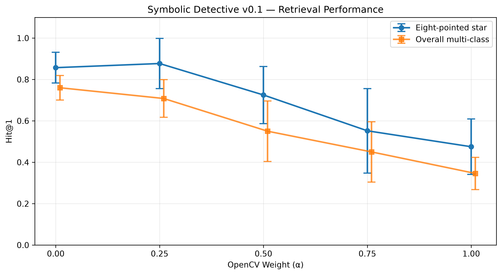

## v0.1 Benchmark: Eight-Pointed Star Retrieval

**Methodology:** 5-Fold Artifact-Grouped Cross-Validation
**Dataset:** 127 total crops (98 valid distinct artifacts)
**Queries Evaluated:** 107 (60 Target `eight_pointed_star`)

Our v0.1 benchmark demonstrates that while deep latent embeddings (DINOv2) provide a strong baseline for general multi-class retrieval, a **hybrid ensemble (Alpha 0.25) leveraging OpenCV geometric features** yields superior Hit@1 and Mean Reciprocal Rank (MRR) for our primary target, the Eight-Pointed Star.

### Target: Eight-Pointed Star (60 queries)
|         **Method**         | Alpha |      Hit@1      |      Hit@5      |       MRR       |
|----------------------------|-------|-----------------|-----------------|-----------------|
| Latent Embeddings (DINOv2) | 0.00  | 0.857 ± 0.074 | **0.985 ± 0.031** | 0.911 ± 0.050 |
| Hybrid Ensemble (Optimal)  | 0.25  | **0.877 ± 0.121** | 0.985 ± 0.031 | **0.925 ± 0.073** |
| Hybrid Ensemble            | 0.50  | 0.725 ± 0.138 | 0.986 ± 0.029 | 0.853 ± 0.079 |
| Hybrid Ensemble            | 0.75  | 0.552 ± 0.204 | 0.986 ± 0.029 | 0.757 ± 0.113 |
| OpenCV Geometric Features  | 1.00  | 0.475 ± 0.134 | 0.952 ± 0.066 | 0.673 ± 0.080 |

### Overall Multi-Class (107 queries)
|         **Method**         | Alpha |      Hit@1      |      Hit@5      |       MRR       |
|----------------------------|-------|-----------------|-----------------|-----------------|
| Latent Embeddings (DINOv2) | 0.00  | **0.760 ± 0.059** | **0.881 ± 0.054** | **0.813 ± 0.044** |
| Hybrid Ensemble            | 0.25  | 0.708 ± 0.091 | 0.871 ± 0.054 | 0.784 ± 0.048 |
| Hybrid Ensemble            | 0.50  | 0.550 ± 0.146 | 0.872 ± 0.044 | 0.708 ± 0.081 |
| Hybrid Ensemble            | 0.75  | 0.450 ± 0.146 | 0.870 ± 0.028 | 0.637 ± 0.081 |
| OpenCV Geometric Features  | 1.00  | 0.346 ± 0.078 | 0.805 ± 0.069 | 0.549 ± 0.059 |

### Retrieval Performance vs. OpenCV Weight

**Figure 1.** Hit@1 retrieval performance across OpenCV geometric-feature weights (α), evaluated using artifact-grouped 5-fold cross-validation. Points represent mean fold performance; error bars indicate ±1 standard deviation. The hybrid configuration (α=0.25) achieves the highest observed eight-pointed star Hit@1, while DINOv2 alone (α=0) performs best overall.