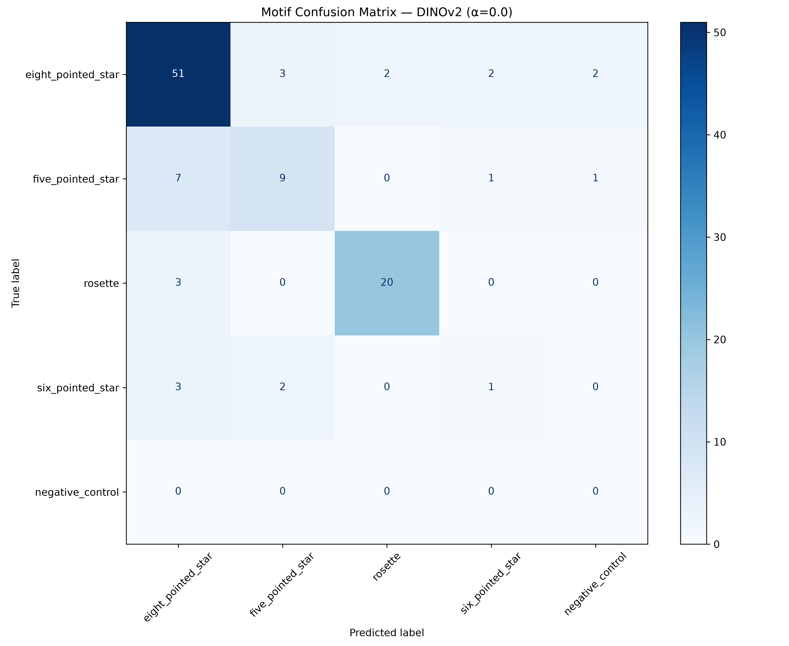
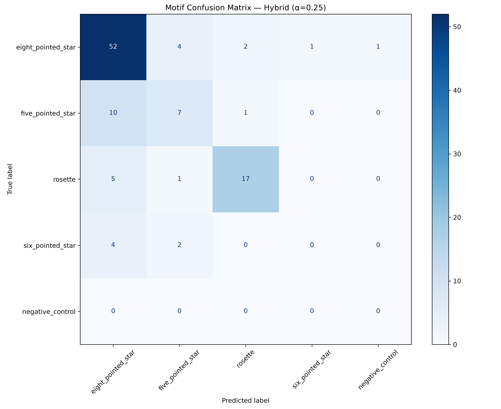

# v0.2 Baseline Evaluation — Related Motif Discrimination

## Goal

Evaluate whether the v0.1 retrieval pipeline can distinguish closely related
motif geometries before introducing v0.2-specific feature improvements.

This baseline uses the original v0.1 dataset and establishes the reference
performance against which later dataset and representation changes will be compared.

## Dataset

- **127 motif crops**
- **98 distinct artifacts**
- **107 evaluated queries**
- Artifact-grouped 5-fold cross-validation

### Class Support

| Class | Queries |
|---|---:|
| eight_pointed_star | 60 |
| five_pointed_star | 18 |
| rosette | 23 |
| six_pointed_star | 6 |

> The dataset is substantially imbalanced, particularly for
> `six_pointed_star`. These results should therefore be interpreted as a
> baseline rather than final v0.2 discrimination performance.

## Retrieval Results

### Overall Multi-Class (107 queries)
|         **Method**         | Alpha |      Hit@1      |      Hit@5      |       MRR       |
|----------------------------|-------|-----------------|-----------------|-----------------|
| Latent Embeddings (DINOv2) | 0.00  | **0.760 ± 0.059** | **0.881 ± 0.054** | **0.813 ± 0.044** |
| Hybrid Ensemble            | 0.25  | 0.708 ± 0.091 | 0.871 ± 0.054 | 0.784 ± 0.048 |
| Hybrid Ensemble            | 0.50  | 0.550 ± 0.146 | 0.872 ± 0.044 | 0.708 ± 0.081 |
| Hybrid Ensemble            | 0.75  | 0.450 ± 0.146 | 0.870 ± 0.028 | 0.637 ± 0.081 |
| OpenCV Geometric Features  | 1.00  | 0.346 ± 0.078 | 0.805 ± 0.069 | 0.549 ± 0.059 |


### Target: Eight-Pointed Star (60 queries)
| **Method**                 | Alpha |      Hit@1      | Hit@5         |       MRR       |
|----------------------------|-------|-----------------|---------------|-----------------|
| Latent Embeddings (DINOv2) | 0.00  | 0.857 ± 0.074 | 0.985 ± 0.031 | 0.911 ± 0.050 |
| Hybrid Ensemble            | 0.25  | **0.877 ± 0.121** | 0.985 ± 0.031 | **0.925 ± 0.073** |
| Hybrid Ensemble            | 0.50  | 0.725 ± 0.138 | 0.986 ± 0.029 | 0.853 ± 0.079 |
| Hybrid Ensemble            | 0.75  | 0.552 ± 0.204 | 0.986 ± 0.029 | 0.757 ± 0.113 |
| OpenCV Geometric Features  | 1.00  | 0.475 ± 0.134 | 0.952 ± 0.066 | 0.673 ± 0.080 |

## Multi-Class Discrimination

### DINOv2 α = 0.0
```text
                    precision    recall  f1-score   support

eight_pointed_star       0.80      0.85      0.82        60
 five_pointed_star       0.64      0.50      0.56        18
           rosette       0.91      0.87      0.89        23
  six_pointed_star       0.25      0.17      0.20         6

         micro avg       0.78      0.76      0.77       107
         macro avg       0.65      0.60      0.62       107
      weighted avg       0.76      0.76      0.76       107
```
### Hybrid α = 0.25
```text
                    precision    recall  f1-score   support

eight_pointed_star       0.73      0.87      0.79        60
 five_pointed_star       0.50      0.39      0.44        18
           rosette       0.85      0.74      0.79        23
  six_pointed_star       0.00      0.00      0.00         6

         micro avg       0.72      0.71      0.71       107
         macro avg       0.52      0.50      0.51       107
      weighted avg       0.68      0.71      0.69       107
```
## Confusion Matrices

### DINOv2



### Hybrid



## Error Analysis

Per-query disagreements between DINOv2 and the hybrid model are recorded in:

`v0.2_baseline_error_analysis.json`

Each error is categorized as:

- `geometry_helped`
- `geometry_hurt`
- `both_wrong`

This allows v0.2 development to focus on motif pairs where explicit geometry
adds or removes useful discrimination.

## Baseline Findings

1. **DINOv2 is currently the strongest general multi-class discriminator.**
   It achieves Hit@1 = **0.760** and MRR = **0.813**.

2. **Explicit geometry remains useful for the primary eight-pointed-star task.**
   Hybrid α = 0.25 improves target Hit@1 from **0.857 → 0.877** and
   MRR from **0.911 → 0.925**.

3. **Geometry improves target-specific retrieval but does not currently improve general discrimination.**
   Hybrid α = 0.25 improves Eight-Pointed Star retrieval, but reduces overall
   Hit@1 from **0.760 → 0.708**.

4. **Six-pointed-star discrimination is currently unreliable.**
   DINOv2 F1 = **0.20**, but only six queries are available, making dataset
   scarcity a major confounding factor.

5. **Rosettes are already comparatively well separated**, while
   five- and six-pointed stars require further investigation.

## Next Step

Expand and rebalance the related-motif dataset before modifying the feature
representation, with priority given to:

- six-pointed stars
- five-pointed stars
- eight-petal rosettes
- radial sunbursts

The same evaluation protocol will then be rerun to distinguish improvements
caused by better dataset coverage from improvements caused by new geometric
representations.