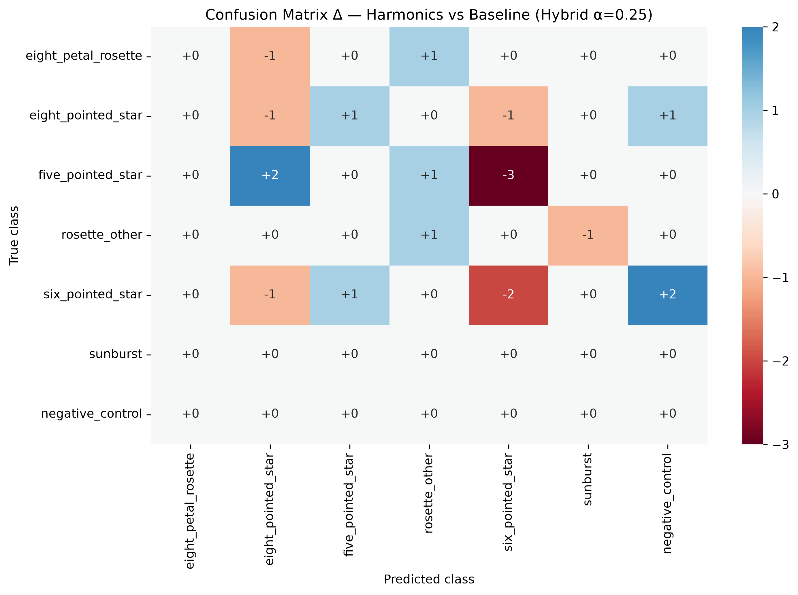

# v0.2 — Experiment 01: Harmonic Features

## 1. Objective and Experimental Setup

### Objective

This experiment investigates whether incorporating radial symmetry harmonics into the geometric feature representation improves fine-grained discrimination between visually similar motif classes.

The primary motivation is the **point-counting problem** observed in the v0.2 development baseline, where five-, six-, and eight-pointed stars are frequently confused despite their distinct geometric structures.

### Experimental Hypothesis

Explicit radial harmonic features may provide complementary geometric information that helps distinguish motifs with different rotational symmetry patterns, potentially improving retrieval ranking and class discrimination.

The experiment evaluates whether these features improve:

- **Retrieval performance:** Hit@1, Hit@5, and Mean Reciprocal Rank (MRR).
- **Multi-class discrimination:** Precision, recall, and F1, particularly for star-shaped motifs.
- **Neighborhood voting:** Accuracy and macro F1 under majority and similarity-weighted voting.

### Feature Modification

The experiment extends the existing OpenCV geometric representation with three harmonic descriptors:

- `harmonic_5`
- `harmonic_6`
- `harmonic_8`

These features are intended to capture radial periodicity associated with five-fold, six-fold, and eight-fold geometric structures.

**Representation comparison:**

| Configuration | Geometric Features |
|---|---|
| v0.2 Development Baseline | Original geometric feature set |
| exp01_harmonics | Original geometric features + harmonic_5, harmonic_6, harmonic_8 |

DINOv2 embeddings remain unchanged. The harmonic descriptors are evaluated through the existing geometric similarity and hybrid retrieval framework.

### Evaluation Protocol

The experiment follows the same evaluation protocol as the [v0.2 Development Baseline](../../v0.2_dev_baseline/evaluation.md):

- **Dataset:** Expanded v0.2 related-motif dataset.
- **Development partition:** 251 source artifacts, with 287 successfully extracted crops.
- **Queries:** 237 motif crops across six target classes.
- **Cross-validation:** Five stratified, artifact-grouped folds to prevent source-artifact leakage.
- **Held-out test:** 74 crops remain excluded from development evaluation.
- **Retrieval configurations:** DINOv2 ($\alpha=0.0$), Hybrid ($\alpha \in \{0.25, 0.50, 0.75\}$), and geometry-only ($\alpha=1.0$).
- **Class voting:** Top-1 ($K=1$), majority voting, and similarity-weighted voting ($K \in \{3,5,7\}$), with artifact deduplication.

All comparisons are conducted against the frozen v0.2 development baseline to isolate the effect of adding harmonic features.

## 2. Retrieval Performance Comparison

This section compares the harmonic-enhanced geometric representation against the frozen v0.2 development baseline.

Results are reported as **mean ± standard deviation across five cross-validation folds**. The change (Δ) represents the difference between harmonic-enhanced and baseline mean scores; positive values indicate improvement.

### 2.1 Overall Multi-Class Retrieval

| α | Metric | Baseline (Mean ± SD) | Harmonics (Mean ± SD) | Δ |
|---|---|---:|---:|---:|
| 0.00 | Hit@1 | 0.604 ± 0.064 | 0.604 ± 0.064 | +0.0000 |
| | Hit@5 | 0.877 ± 0.019 | 0.877 ± 0.019 | +0.0000 |
| | MRR | 0.720 ± 0.040 | 0.720 ± 0.040 | +0.0000 |
| 0.25 | Hit@1 | 0.606 ± 0.037 | 0.596 ± 0.064 | −0.0095 |
| | Hit@5 | 0.872 ± 0.043 | 0.872 ± 0.053 | +0.0000 |
| | MRR | 0.719 ± 0.036 | 0.717 ± 0.053 | −0.0022 |
| 0.50 | Hit@1 | 0.498 ± 0.075 | 0.512 ± 0.055 | +0.0138 |
| | Hit@5 | 0.891 ± 0.039 | 0.894 ± 0.046 | +0.0033 |
| | MRR | 0.665 ± 0.055 | 0.670 ± 0.047 | +0.0049 |
| 0.75 | Hit@1 | 0.354 ± 0.110 | 0.359 ± 0.073 | +0.0043 |
| | Hit@5 | 0.779 ± 0.077 | 0.798 ± 0.069 | +0.0190 |
| | MRR | 0.538 ± 0.087 | 0.546 ± 0.061 | +0.0073 |
| 1.00 | Hit@1 | 0.267 ± 0.096 | 0.237 ± 0.075 | −0.0298 |
| | Hit@5 | 0.648 ± 0.085 | 0.660 ± 0.067 | +0.0123 |
| | MRR | 0.442 ± 0.079 | 0.427 ± 0.066 | −0.0148 |

*Δ values are computed from unrounded means.*

**Observations:**

- **DINOv2 (α=0.0):** Results remain identical, as expected, since the latent embeddings are unchanged.
- **Hybrid (α=0.25):** Hit@1 decreases slightly, while Hit@5 remains unchanged and MRR decreases marginally.
- **Hybrid (α=0.50–0.75):** Small improvements appear across retrieval metrics, particularly Hit@5 at α=0.75.
- **Geometry-only (α=1.0):** Hit@1 and MRR decrease despite a modest improvement in Hit@5, indicating that the added harmonic features do not improve top-ranked retrieval on their own.

### 2.2 Target-Class Retrieval: `eight_pointed_star`

The target-class evaluation focuses on 52 query crops belonging to `eight_pointed_star`, allowing closer inspection of the effect of harmonic features on eight-fold star motifs.

| α | Metric | Baseline (Mean ± SD) | Harmonics (Mean ± SD) | Δ |
|---|---|---:|---:|---:|
| 0.00 | Hit@1 | 0.753 ± 0.059 | 0.753 ± 0.059 | +0.0000 |
| | Hit@5 | 0.960 ± 0.049 | 0.960 ± 0.049 | +0.0000 |
| | MRR | 0.829 ± 0.044 | 0.829 ± 0.044 | +0.0000 |
| 0.25 | Hit@1 | 0.746 ± 0.086 | 0.728 ± 0.078 | −0.0182 |
| | Hit@5 | 0.938 ± 0.051 | 0.938 ± 0.051 | +0.0000 |
| | MRR | 0.834 ± 0.075 | 0.825 ± 0.068 | −0.0088 |
| 0.50 | Hit@1 | 0.667 ± 0.076 | 0.687 ± 0.086 | +0.0204 |
| | Hit@5 | 0.960 ± 0.080 | 0.980 ± 0.040 | +0.0200 |
| | MRR | 0.787 ± 0.056 | 0.801 ± 0.071 | +0.0140 |
| 0.75 | Hit@1 | 0.458 ± 0.118 | 0.439 ± 0.121 | −0.0196 |
| | Hit@5 | 0.825 ± 0.076 | 0.898 ± 0.090 | +0.0730 |
| | MRR | 0.623 ± 0.079 | 0.625 ± 0.096 | +0.0020 |
| 1.00 | Hit@1 | 0.363 ± 0.043 | 0.288 ± 0.049 | −0.0748 |
| | Hit@5 | 0.684 ± 0.119 | 0.726 ± 0.113 | +0.0422 |
| | MRR | 0.521 ± 0.049 | 0.488 ± 0.061 | −0.0330 |

*Δ values are computed from unrounded means.*

**Observations:**

- **Hybrid (α=0.25):** Slight reductions in Hit@1 and MRR, with no change in Hit@5.
- **Hybrid (α=0.50):** Improvements across all three retrieval metrics, although performance remains below the DINOv2-only configuration.
- **Hybrid (α=0.75):** A noticeable Hit@5 improvement (+0.0730), accompanied by lower Hit@1.
- **Geometry-only (α=1.0):** Hit@5 increases, but Hit@1 drops substantially, indicating that more correct-class candidates appear within the top five without improving their highest-rank placement.

### 2.3 Preliminary Retrieval Assessment

Harmonic augmentation produces **mixed retrieval effects rather than a consistent improvement**.

At intermediate hybrid weights, some improvements are observed in candidate retrieval within the Top-5 neighborhood. However, geometry-only Hit@1 decreases for both overall retrieval and the eight-pointed-star target class.

These observations motivate further examination of per-class discrimination and confusion patterns to determine whether harmonic features improve the separation of closely related star geometries.

The differences are descriptive development-set observations and have not been established as statistically significant.

## 3. Multi-Class Discrimination Analysis

This section evaluates whether harmonic features improve Top-1 classification across the six motif classes.

Unlike the cross-validation retrieval metrics in Section 2, precision, recall, and F1 are calculated from **pooled predictions across all five cross-validation folds (237 queries)**.

Since DINOv2 embeddings remain unchanged, the analysis focuses on the Hybrid representation (α=0.25).

### 3.1 Per-Class Performance Comparison

| Motif class | Support | Baseline P | Baseline R | Baseline F1 | Harmonics P | Harmonics R | Harmonics F1 | Δ F1 |
|---|---:|---:|---:|---:|---:|---:|---:|---:|
| eight_petal_rosette | 34 | 0.667 | 0.647 | 0.657 | 0.667 | 0.647 | 0.657 | +0.0000 |
| eight_pointed_star | 52 | 0.582 | 0.750 | 0.655 | 0.576 | 0.731 | 0.644 | −0.0114 |
| five_pointed_star | 42 | 0.585 | 0.571 | 0.578 | 0.558 | 0.571 | 0.565 | −0.0136 |
| rosette_other | 31 | 0.621 | 0.581 | 0.600 | 0.594 | 0.613 | 0.603 | +0.0032 |
| six_pointed_star | 41 | 0.571 | 0.488 | 0.526 | 0.621 | 0.439 | 0.514 | −0.0120 |
| sunburst | 37 | 0.840 | 0.568 | 0.677 | 0.875 | 0.568 | 0.689 | +0.0111 |
| **Micro avg** | **237** | 0.626 | 0.608 | 0.617 | 0.626 | 0.599 | 0.612 | −0.0046 |
| **Macro avg** | **237** | 0.644 | 0.601 | 0.616 | 0.648 | 0.595 | 0.612 | −0.0038 |
| **Weighted avg** | **237** | 0.638 | 0.608 | 0.616 | 0.643 | 0.599 | 0.611 | −0.0048 |

*P = Precision, R = Recall. Δ F1 = Harmonics − Baseline, calculated from unrounded values.*

**Observations:**

- **Overall discrimination:** Macro F1 decreases slightly from 0.6157 to 0.6119, indicating no aggregate improvement in Top-1 classification.
- **Star motifs:** All three star classes exhibit small F1 decreases after introducing harmonic features.
- **Rosette motifs:** `eight_petal_rosette` remains unchanged, while `rosette_other` shows a marginal F1 improvement.
- **Sunburst:** F1 improves from 0.677 to 0.689, primarily through increased precision rather than recall.

### 3.2 Star-Class Discrimination: The Point-Counting Problem

To assess whether harmonics improve discrimination between five-, six-, and eight-pointed stars, we examine changes in precision, recall, and F1 independently.

| Star class | Δ Precision | Δ Recall | Δ F1 |
|---|---:|---:|---:|
| five_pointed_star | −0.0272 | +0.0000 | −0.0136 |
| six_pointed_star | +0.0493 | −0.0488 | −0.0120 |
| eight_pointed_star | −0.0063 | −0.0192 | −0.0114 |

**Key observations:**

- **`five_pointed_star`:** Recall remains unchanged at 57.1%, while precision decreases. Harmonics do not improve identification of actual five-pointed stars and introduce additional false positives.
- **`six_pointed_star`:** Precision increases from 57.1% to 62.1%, but recall decreases from 48.8% to 43.9%. Predictions of this class become more precise, but fewer actual six-pointed stars are correctly identified.
- **`eight_pointed_star`:** Both precision and recall decrease slightly. The representation does not improve recognition of eight-fold star

## 4. Confusion Pattern Analysis

This section examines how harmonic features affect class-to-class misclassification patterns under Hybrid Top-1 retrieval (α=0.25).

The difference matrix is computed as:

**Δ Confusion Matrix = Harmonics − Baseline**

- **Diagonal:** Positive values indicate more correct classifications; negative values indicate fewer.
- **Off-diagonal:** Negative values indicate fewer misclassifications between the corresponding classes; positive values indicate more.

### 4.1 Confusion Matrix Difference

The matrix reveals several changes in prediction distribution, particularly among the three star classes.

### 4.2 Star-Class Confusion Changes

| True class | Predicted class | Δ Count |
|---|---|---:|
| five_pointed_star | eight_pointed_star | +2 |
| five_pointed_star | six_pointed_star | −3 |
| six_pointed_star | five_pointed_star | +1 |
| six_pointed_star | eight_pointed_star | −1 |
| six_pointed_star | negative_control | +2 |
| eight_pointed_star | five_pointed_star | +1 |
| eight_pointed_star | six_pointed_star | −1 |
| eight_pointed_star | negative_control | +1 |

**Key observations:**

- **Five-pointed stars:** Confusion with six-pointed stars decreases by three predictions, but confusion with eight-pointed stars increases by two. The number of correctly classified five-pointed stars remains unchanged (24/42).

- **Six-pointed stars:** Correct classifications decrease from 20 to 18 out of 41 queries. Although confusion with eight-pointed stars decreases slightly, two additional queries are classified as `negative_control`.

- **Eight-pointed stars:** Correct classifications decrease from 39 to 38 out of 52 queries. Confusion with six-pointed stars decreases by one, but misclassification as five-pointed stars and `negative_control` each increases by one.

These changes indicate a **redistribution of classification errors rather than a systematic reduction in star-class confusion**.

### 4.3 Other Motif Classes and Negative Controls

Outside the star classes, changes are relatively small:

- `eight_petal_rosette` retains 22 correct classifications, with minor changes in its misclassification distribution.
- `rosette_other` improves from 18 to 19 correct classifications.
- `sunburst` predictions remain unchanged.

The increased prediction of `negative_control` for some star queries is also noteworthy. Although negative-control images are included in the retrieval corpus, they are excluded from the query set. Consequently, the negative-control row contains no evaluated queries, but its prediction column captures incorrect assignments of valid motifs to that class.

### 4.4 Confusion Pattern Assessment

Harmonic augmentation does not consistently improve separation between five-, six-, and eight-pointed stars.

Some individual confusion pairs improve, particularly `five_pointed_star` → `six_pointed_star`, but these reductions do not translate into improved overall star-class recognition.

The decrease in correct six-pointed-star predictions and the additional assignments to `negative_control` suggest that the current harmonic-enhanced representation may alter nearest-neighbor rankings without reliably preserving motif identity.

These findings reinforce the need to investigate whether **neighborhood aggregation can benefit from the modified retrieval rankings**, even when Top-1 classification does not improve.

## 5. Class Voting Performance Comparison

This section evaluates whether harmonic features improve neighborhood-based motif classification through majority and similarity-weighted voting.

The experiment compares the frozen v0.2 development baseline against the harmonic-enhanced representation using artifact-deduplicated Top-K retrieval.

Results are reported as **mean ± standard deviation across five cross-validation folds**. Δ values represent the difference between harmonic-enhanced and baseline mean scores.

### 5.1 Hybrid Voting Performance (α=0.25)

| Strategy | K | Baseline Accuracy | Harmonics Accuracy | Δ Accuracy | Baseline Macro F1 | Harmonics Macro F1 | Δ Macro F1 |
|---|---:|---:|---:|---:|---:|---:|---:|
| **Top-1** | 1 | 0.6058 ± 0.0374 | 0.5962 ± 0.0645 | −0.0096 | 0.6089 ± 0.0358 | 0.6069 ± 0.0638 | −0.0020 |
| Majority | 3 | 0.5944 ± 0.0559 | 0.6076 ± 0.0738 | +0.0132 | 0.5913 ± 0.0581 | 0.6071 ± 0.0767 | +0.0158 |
| Majority | 5 | 0.6076 ± 0.0131 | 0.6330 ± 0.0259 | +0.0254 | 0.6067 ± 0.0217 | 0.6300 ± 0.0299 | +0.0233 |
| Majority | 7 | 0.6187 ± 0.0447 | 0.6395 ± 0.0474 | +0.0208 | 0.6184 ± 0.0467 | 0.6375 ± 0.0509 | +0.0191 |
| Weighted | 3 | 0.5944 ± 0.0559 | 0.6076 ± 0.0738 | +0.0132 | 0.5913 ± 0.0581 | 0.6071 ± 0.0767 | +0.0158 |
| Weighted | 5 | 0.6076 ± 0.0131 | 0.6158 ± 0.0218 | +0.0082 | 0.6067 ± 0.0217 | 0.6093 ± 0.0285 | +0.0026 |
| **Weighted** | **7** | **0.6185 ± 0.0443** | **0.6483 ± 0.0407** | **+0.0298** | **0.6214 ± 0.0425** | **0.6463 ± 0.0413** | **+0.0249** |

**Key observations:**

- **Top-1 performance:** Harmonic augmentation slightly decreases both accuracy and macro F1, consistent with the retrieval and discrimination results from Sections 2 and 3.
- **Neighborhood voting:** Both majority and weighted voting improve over their corresponding baseline configurations across all tested neighborhood sizes (K=3, 5, 7).
- **Best-performing configuration:** Hybrid Weighted K=7 achieves the highest observed accuracy (0.6483) and macro F1 (0.6463), improving by 2.98 and 2.49 percentage points, respectively, over the corresponding baseline.
- **Neighborhood size:** Larger neighborhoods generally benefit the harmonic-enhanced representation, with K=7 producing the strongest results among the tested configurations.
- **Weighting strategy:** Similarity weighting does not consistently outperform majority voting. At K=5, majority voting achieves higher macro F1 (0.6300 vs. 0.6093), while weighted voting performs better at K=7 (0.6463 vs. 0.6375).

### 5.2 DINOv2 Voting Performance (α=0.0)

DINOv2 voting results remain identical between baseline and harmonic experiments, as expected, since harmonic descriptors affect only the geometric representation.

The strongest DINOv2 voting configurations remain Majority K=3 and Weighted K=3, both achieving:

- **Accuracy:** 0.6144 ± 0.0530
- **Macro F1:** 0.6082 ± 0.0565

The harmonic-enhanced Hybrid Weighted K=7 configuration exceeds these observed scores, although the improvement depends on the chosen representation and neighborhood size.

### 5.3 Voting Performance Assessment

The voting results reveal an important contrast with Top-1 classification.

Although harmonic augmentation does not improve Top-1 accuracy or macro F1 at α=0.25, it improves performance when predictions are aggregated across multiple retrieved artifacts.

This suggests that harmonic features may modify the local retrieval neighborhood in ways that support class-level consensus, even when the highest-ranked neighbor is not more frequently correct.

However, this interpretation remains a hypothesis. The current aggregate metrics do not establish whether harmonics increase the concentration of correct-class neighbors or simply redistribute similarity rankings.

Furthermore, **improved aggregate voting performance does not necessarily imply that the point-counting problem has been resolved**. Per-class voting analysis is needed to establish whether the improvements extend to five-, six-, and eight-pointed-star discrimination.

The observed gains are limited to development-set cross-validation and should not be treated as statistically established improvements without further analysis.

Overall, the results indicate that **harmonic features offer more promising benefits through neighborhood aggregation than through strict Top-1 classification**, motivating investigation of additional geometric descriptors and their interactions with retrieval and voting strategies.

## 6. Key Findings and Interpretation

### 6.1 Summary of Experimental Findings

The experiment evaluated whether adding radial symmetry harmonics (`harmonic_5`, `harmonic_6`, `harmonic_8`) improves fine-grained motif discrimination relative to the frozen v0.2 development baseline.

Four main findings emerged:

1. **No consistent improvement in retrieval performance.** Harmonic augmentation produced mixed results across retrieval configurations. Geometry-only Hit@1 decreased from 0.267 to 0.237, while intermediate hybrid configurations showed small improvements in selected metrics, particularly Hit@5.

2. **The point-counting problem remains unresolved.** Under Hybrid Top-1 (α=0.25), all three star classes experienced small F1 decreases. Six-pointed-star recall declined from 48.8% to 43.9%, while confusion matrix analysis revealed a redistribution of errors rather than consistent improvements in star-class separation.

3. **Neighborhood voting benefited from harmonic augmentation.** Despite weaker Top-1 performance, all tested Hybrid majority and weighted voting configurations (K=3, 5, 7) improved relative to their corresponding baselines. The strongest observed configuration, Weighted K=7, increased cross-validation macro F1 from 0.6214 to 0.6463.

4. **Benefits depend on the retrieval and aggregation configuration.** Harmonic features did not consistently improve results across all α values or voting strategies. Their contribution appears sensitive to how geometric similarity is combined with latent embeddings and how retrieved neighbors are aggregated.

### 6.2 Interpretation: Retrieval Ranking vs. Neighborhood Structure

The contrast between Top-1 and voting performance is the most interesting outcome of this experiment.

One possible explanation is that harmonic features alter similarity rankings without consistently improving the identity of the highest-ranked neighbor. These changes may nevertheless produce neighborhoods that are more useful for class-level aggregation.

However, the current aggregate results do not establish this mechanism. Confirming it would require examining the class composition, similarity distributions, and prediction changes within Top-K neighborhoods.

An alternative explanation is that the observed voting gains are sensitive to particular neighborhood sizes, samples, or cross-validation folds.

Therefore, the findings support further investigation of the interaction between harmonic descriptors and neighborhood voting, rather than demonstrating that harmonic features independently improve motif discrimination.

### 6.3 Experimental Limitations

Several limitations should be considered when interpreting these results:

- **Limited geometric discrimination:** The current harmonic representation does not reliably separate motifs according to their number of points.
- **Representation interactions:** Harmonics were evaluated as additional features within the existing geometric representation. Their independent contribution has not been isolated.
- **Development-set evaluation:** Results are based on five artifact-grouped cross-validation folds. The held-out test partition remains untouched.
- **Exploratory configuration selection:** Multiple α values, voting strategies, and neighborhood sizes were evaluated. The best observed configuration may not generalize.
- **Unverified class-specific voting improvements:** Higher aggregate voting macro F1 does not establish that voting specifically improves discrimination among five-, six-, and eight-pointed stars.

### 6.4 Overall Assessment

**The original hypothesis is not supported for strict Top-1 star-class discrimination, but harmonic augmentation shows preliminary promise when combined with neighborhood-based voting.**

The experiment suggests that explicit radial symmetry information may contribute useful complementary signals, although the current implementation is insufficient to reliably resolve point-counting ambiguities.

The next experiments should investigate whether combining harmonic descriptors with more explicit geometric characteristics—particularly radial peak detection and pointedness—improves both individual retrieval rankings and class-level discrimination.

Harmonics should therefore be retained as a candidate feature for further ablation studies, rather than considered a validated improvement to the geometric representation.

## 7. Next Steps

The results of `exp01_harmonics` motivate a systematic investigation of additional geometric descriptors to determine which features contribute to fine-grained motif discrimination.

Rather than progressively adding features, the next phase will evaluate each feature group independently against the frozen v0.2 development baseline.

### 7.1 Phase A — Independent Feature Evaluation

Each experiment extends the original geometric representation with a single feature group.

| Experiment | Added Features | Research Question |
|---|---|---|
| `exp01_harmonics` | Radial harmonics (5, 6, 8) | Does rotational symmetry information improve motif discrimination? |
| `exp02_peaks` | Radial peak detection | Does explicit peak detection improve star point-count discrimination? |
| `exp03_pointedness` | Tip sharpness / pointedness | Can angular and rounded motif structures be distinguished more reliably? |
| `exp04_radius` | Radial profile characteristics | Does radial variation provide additional discriminative information? |
| `exp05_central_structure` | Central disk / ring descriptors | Can internal structural features improve separation of stars, rosettes, and sunbursts? |

The objective is to measure the incremental contribution of each feature group independently, without confounding its effect with other newly introduced descriptors.

### 7.2 Phase B — Feature Combination

Following individual feature evaluation, promising descriptors will be combined to investigate complementary effects and feature interactions.

Combination experiments will be informed by individual results rather than assuming that adding more geometric features necessarily improves performance.

### 7.3 Evaluation Consistency

All experiments will follow the same development evaluation protocol:

- Identical dataset partitions and artifact-grouped cross-validation folds.
- Consistent retrieval configurations, voting strategies, and neighborhood sizes.
- Retrieval comparison using Hit@1, Hit@5, and MRR.
- Multi-class discrimination comparison using precision, recall, and F1.
- Confusion-pattern analysis focusing on five-, six-, and eight-pointed stars.
- Class voting evaluation to investigate improvements beyond Top-1 classification.

Feature scaling will continue to be fitted exclusively on the training/retrieval corpus within each cross-validation fold.

The held-out test partition will remain untouched during feature development and experimental selection.

### 7.4 Expected Outcome

The goal is to identify which geometric descriptors provide useful complementary information to DINOv2 embeddings and whether their combinations improve fine-grained motif discrimination.

Particular emphasis will be placed on distinguishing improvements in **Top-1 recognition** from improvements in **Top-K neighborhood quality and class voting**.

The resulting evidence will guide the selection of a geometric feature representation for subsequent v0.2 validation.
