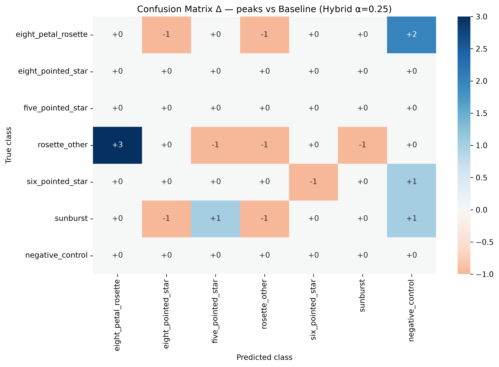

# v0.2 — Experiment 02: Radial Peak Features

## 1. Objective and Experimental Setup

### Objective

This experiment investigates whether adding **radial peak descriptors** to the original geometric representation improves fine-grained motif retrieval and discrimination, particularly the **point-counting problem** involving five-, six-, and eight-pointed stars.

### Experimental Hypothesis

Explicit information about radial maxima may help distinguish motifs with different numbers of prominent points. The hypothesis is evaluated at three levels: retrieval ranking (Hit@1, Hit@5, MRR), Top-1 multi-class discrimination (precision, recall, F1), and artifact-deduplicated class voting (accuracy and macro F1).

### Feature Modification

| Configuration | Geometric representation |
|---|---|
| Frozen v0.2 development baseline | Original geometric feature set |
| `exp02_peaks` | Original geometric features + radial peak descriptors |

**This is an independent feature-augmentation experiment:** harmonics and the other new feature groups are **not** cumulatively enabled. DINOv2 embeddings are unchanged.

### Evaluation Protocol

The experiment follows the same evaluation protocol as the [v0.2 Development Baseline](../../v0.2_dev_baseline/evaluation.md):

- **Dataset:** Expanded v0.2 related-motif dataset.
- **Development partition:** 251 source artifacts, with 287 successfully extracted crops.
- **Queries:** 237 motif crops across six target classes.
- **Cross-validation:** Five stratified, artifact-grouped folds to prevent source-artifact leakage.
- **Held-out test:** 74 crops remain excluded from development evaluation.
- **Retrieval configurations:** DINOv2 ($\alpha=0.0$), Hybrid ($\alpha \in \{0.25, 0.50, 0.75\}$), and geometry-only ($\alpha=1.0$).
- **Class voting:** Top-1 ($K=1$), majority voting, and similarity-weighted voting ($K \in \{3,5,7\}$), with artifact deduplication.

All comparisons are conducted against the frozen v0.2 development baseline to isolate the effect of adding harmonic features.

## 2. Retrieval Performance Comparison

Results are reported as **mean ± standard deviation across five cross-validation folds**. Δ represents experiment − baseline, calculated from unrounded means; positive values indicate improvement.

### 2.1 Overall Multi-Class Retrieval

| α | Metric | Baseline (Mean ± SD) | Peaks (Mean ± SD) | Δ |
|---:|---|---:|---:|---:|
| 0.00 | Hit@1 | 0.6042 ± 0.0636 | 0.6042 ± 0.0636 | +0.0000 |
| | Hit@5 | 0.8769 ± 0.0193 | 0.8769 ± 0.0193 | +0.0000 |
| | MRR | 0.7200 ± 0.0397 | 0.7200 ± 0.0397 | +0.0000 |
| 0.25 | Hit@1 | 0.6058 ± 0.0374 | 0.5962 ± 0.0550 | −0.0095 |
| | Hit@5 | 0.8716 ± 0.0428 | 0.8799 ± 0.0500 | +0.0083 |
| | MRR | 0.7193 ± 0.0359 | 0.7146 ± 0.0415 | −0.0047 |
| 0.50 | Hit@1 | 0.4979 ± 0.0749 | 0.5146 ± 0.0762 | +0.0167 |
| | Hit@5 | 0.8907 ± 0.0391 | 0.8946 ± 0.0453 | +0.0039 |
| | MRR | 0.6654 ± 0.0552 | 0.6754 ± 0.0548 | +0.0101 |
| 0.75 | Hit@1 | 0.3543 ± 0.1102 | 0.3667 ± 0.0638 | +0.0125 |
| | Hit@5 | 0.7786 ± 0.0774 | 0.7922 ± 0.0997 | +0.0136 |
| | MRR | 0.5383 ± 0.0871 | 0.5563 ± 0.0516 | +0.0180 |
| 1.00 | Hit@1 | 0.2667 ± 0.0962 | 0.2608 ± 0.0660 | −0.0059 |
| | Hit@5 | 0.6476 ± 0.0851 | 0.6863 ± 0.0834 | +0.0386 |
| | MRR | 0.4422 ± 0.0790 | 0.4486 ± 0.0512 | +0.0064 |

**Observations.** DINOv2-only results remain unchanged, as expected. At α=0.25, Hit@5 improves slightly while Hit@1 and MRR decrease. Intermediate hybrid weights (α=0.50 and 0.75) show modest improvements across all three metrics. Geometry-only Hit@5 increases by 0.0386, but Hit@1 declines by 0.0059; more same-class candidates appear in the Top-5 without a consistent improvement in the top-ranked match.

### 2.2 Target-Class Retrieval: `eight_pointed_star` (52 Queries)

| α | Metric | Baseline (Mean ± SD) | Peaks (Mean ± SD) | Δ |
|---:|---|---:|---:|---:|
| 0.00 | Hit@1 | 0.7525 ± 0.0589 | 0.7525 ± 0.0589 | +0.0000 |
| | Hit@5 | 0.9600 ± 0.0490 | 0.9600 ± 0.0490 | +0.0000 |
| | MRR | 0.8293 ± 0.0440 | 0.8293 ± 0.0440 | +0.0000 |
| 0.25 | Hit@1 | 0.7459 ± 0.0863 | 0.7459 ± 0.0863 | +0.0000 |
| | Hit@5 | 0.9378 ± 0.0510 | 0.9378 ± 0.0510 | +0.0000 |
| | MRR | 0.8342 ± 0.0750 | 0.8310 ± 0.0728 | −0.0032 |
| 0.50 | Hit@1 | 0.6666 ± 0.0755 | 0.6866 ± 0.0681 | +0.0200 |
| | Hit@5 | 0.9600 ± 0.0800 | 0.9356 ± 0.0879 | −0.0244 |
| | MRR | 0.7866 ± 0.0557 | 0.7999 ± 0.0684 | +0.0132 |
| 0.75 | Hit@1 | 0.4583 ± 0.1183 | 0.4142 ± 0.1342 | −0.0440 |
| | Hit@5 | 0.8247 ± 0.0759 | 0.8429 ± 0.0827 | +0.0182 |
| | MRR | 0.6231 ± 0.0794 | 0.6034 ± 0.0921 | −0.0197 |
| 1.00 | Hit@1 | 0.3627 ± 0.0427 | 0.3041 ± 0.0933 | −0.0586 |
| | Hit@5 | 0.6839 ± 0.1190 | 0.7462 ± 0.0963 | +0.0622 |
| | MRR | 0.5215 ± 0.0488 | 0.4867 ± 0.0875 | −0.0348 |

**Observations.** The target-class geometry-only configuration shows a substantial divergence between Top-5 candidate retrieval (Δ Hit@5 = +0.0622) and first-rank matching (Δ Hit@1 = −0.0586). The α=0.25 target Hit@1 and Hit@5 remain unchanged. These results do not support a reliable improvement in eight-pointed-star Top-1 retrieval.

### 2.3 Fold-Level Consistency and Retrieval Assessment

To assess whether the observed retrieval changes are consistent across cross-validation folds, paired fold-level differences were examined for overall Hit@1.

| α | Improved folds | Worsened folds | Unchanged folds | Mean Δ Hit@1 |
|---|---:|---:|---:|---:|
| 0.00 | 0 | 0 | 5 | +0.0000 |
| 0.25 | 1 | 2 | 2 | −0.0095 |
| 0.50 | 3 | 2 | 0 | +0.0167 |
| 0.75 | 2 | 1 | 2 | +0.0125 |
| 1.00 | 2 | 1 | 2 | −0.0059 |

**Key observations:**

- **Hybrid configurations (α=0.25–0.75):** Fold-level effects are mixed. At α=0.50, Hit@1 improves in three of five folds, while α=0.25 shows more worsened than improved folds.
- **Geometry-only (α=1.00):** Two folds improve, one worsens, and two remain unchanged. One fold improves by +0.0870, while another declines by −0.1364, producing a slightly negative mean despite more improved than worsened folds.
- **Top-5 retrieval:** Improvements in Hit@5, particularly for geometry-only retrieval, do not consistently translate into better first-rank matching.

Overall, radial peak augmentation produces **mixed retrieval effects without consistent fold-level improvement**. Unlike harmonics, which worsened geometry-only Hit@1 in four folds, peaks exhibit greater variation in both the direction and magnitude of fold-level changes.

These differences are descriptive development-set observations and have not been established as statistically significant.

## 3. Multi-Class Discrimination Analysis

This section compares **pooled Top-1 predictions across all five folds (237 queries)** for Hybrid α=0.25. The pooled per-class metrics are distinct from the fold-averaged retrieval and voting metrics.

### 3.1 Per-Class Performance  Comparison

| Motif class | Support | Baseline P | Peaks P | Baseline R | Peaks R | Baseline F1 | Peaks F1 | Δ F1 |
|---|---:|---:|---:|---:|---:|---:|---:|---:|
| `eight_petal_rosette` | 34 | 0.6667 | 0.6111 | 0.6471 | 0.6471 | 0.6567 | 0.6286 | −0.0281 |
| `eight_pointed_star` | 52 | 0.5821 | 0.6000 | 0.7500 | 0.7500 | 0.6555 | 0.6667 | +0.0112 |
| `five_pointed_star` | 42 | 0.5854 | 0.5854 | 0.5714 | 0.5714 | 0.5783 | 0.5783 | +0.0000 |
| `rosette_other` | 31 | 0.6207 | 0.6538 | 0.5806 | 0.5484 | 0.6000 | 0.5965 | −0.0035 |
| `six_pointed_star` | 41 | 0.5714 | 0.5588 | 0.4878 | 0.4634 | 0.5263 | 0.5067 | −0.0196 |
| `sunburst` | 37 | 0.8400 | 0.8750 | 0.5676 | 0.5676 | 0.6774 | 0.6885 | +0.0111 |
| **Micro avg** | **237** | 0.6261 | 0.6283 | 0.6076 | 0.5992 | 0.6167 | 0.6134 | −0.0033 |
| **Macro avg** | **237** | 0.6444 | 0.6474 | 0.6008 | 0.5913 | 0.6157 | 0.6109 | −0.0048 |
| **Weighted avg** | **237** | 0.6383 | 0.6419 | 0.6076 | 0.5992 | 0.6158 | 0.6121 | −0.0037 |

*P = precision; R = recall. DINOv2 (α=0.0) per-class results are unchanged.*

### 3.2 Star-Class Discrimination: The Point-Counting Problem

To assess whether radial peak features improve discrimination between five-, six-, and eight-pointed stars, we examine changes in precision, recall, and F1 independently under Hybrid Top-1 classification (α=0.25).

| Star class | Δ Precision | Δ Recall | Δ F1 |
|---|---:|---:|---:|
| five_pointed_star | +0.0000 | +0.0000 | +0.0000 |
| six_pointed_star | −0.0126 | −0.0244 | −0.0196 |
| eight_pointed_star | +0.0179 | +0.0000 | +0.0112 |

**Key observations:**
- **`five_pointed_star`:** Precision, recall, and F1 remain unchanged. Radial peaks do not improve identification of five-pointed stars.
- **`six_pointed_star`:** Both precision and recall decrease. Recall declines from 48.8% to 46.3% (20 → 19 correct predictions among 41 queries), resulting in a decrease in F1.
- **`eight_pointed_star`:** Precision improves from 58.2% to 60.0%, while recall remains unchanged at 75.0%. This reflects fewer false positives from other motif families rather than additional correctly classified eight-pointed stars.

Overall pooled macro F1 decreases from 0.6157 to 0.6109 (Δ = −0.0048).

**Radial peaks do not resolve the point-counting problem under Hybrid Top-1 classification.** The small improvement for eight-pointed stars does not translate into a systematic reduction in confusion among the three star classes.

## 4. Confusion Pattern Analysis

The confusion-matrix difference is **Peaks − Baseline** for Hybrid Top-1 (α=0.25). Positive diagonal values indicate more correct predictions; negative off-diagonal values indicate fewer misclassifications of the corresponding type.

### 4.1 Confusion Matrix Analysis

### 4.2 Star-Class Confusions Changes

| True class | Baseline correct | Peaks correct | Δ |
|---|---:|---:|---:|
| `eight_pointed_star` | 39 / 52 | 39 / 52 | 0 |
| `five_pointed_star` | 24 / 42 | 24 / 42 | 0 |
| `six_pointed_star` | 20 / 41 | 19 / 41 | −1 |

All **off-diagonal transitions between the three star classes are unchanged**. The one lost six-pointed-star correct prediction becomes an additional `negative_control` prediction. Peaks therefore do not reduce direct confusion between different star point counts at Top-1.

### 4.3 Other Motif Classes and Negative Controls

- **`eight_petal_rosette`:** Correct predictions remain at 22 / 34; two more queries are assigned to `negative_control` instead of `eight_pointed_star` or `rosette_other`.
- **`rosette_other`:** Correct predictions decline from 18 to 17 / 31, while three additional queries are assigned to `eight_petal_rosette`.
- **`sunburst`:** Correct predictions remain at 21 / 37, but errors are redistributed, including one additional prediction of `negative_control`.
- **Negative-control assignments:** Across all query classes, four additional valid motif queries are predicted as `negative_control`.

Negative controls are retrieval candidates but **not evaluation queries**, explaining the all-zero `negative_control` row. The shifts reflect changes to nearest-neighbor assignments rather than improved star point-count separation.

## 5. Class Voting Performance Comparison

This section compares baseline and feature-augmented class voting using artifact-deduplicated Top-K retrieval. The primary analysis focuses on Hybrid α=0.25.
Results are reported as **mean ± standard deviation across five cross-validation folds**. Δ values represent experiment − baseline.

### 5.1 Hybrid Voting Performance (α=0.25)

| Strategy | K | Baseline Accuracy | Peaks Accuracy | Δ Accuracy | Baseline Macro F1 | Peaks Macro F1 | Δ Macro F1 |
|---|---:|---:|---:|---:|---:|---:|---:|
| **Top-1** | 1 | 0.6058 ± 0.0374 | 0.5962 ± 0.0550 | −0.0095 | 0.6089 ± 0.0358 | 0.6040 ± 0.0535 | −0.0049 |
| Majority | 3 | 0.5944 ± 0.0559 | 0.6073 ± 0.0638 | +0.0128 | 0.5913 ± 0.0581 | 0.6108 ± 0.0682 | +0.0195 |
| Majority | 5 | 0.6076 ± 0.0131 | 0.5932 ± 0.0421 | −0.0144 | 0.6067 ± 0.0217 | 0.5955 ± 0.0420 | −0.0112 |
| Majority | 7 | 0.6187 ± 0.0447 | 0.6265 ± 0.0632 | +0.0078 | 0.6184 ± 0.0467 | 0.6157 ± 0.0560 | −0.0026 |
| Weighted | 3 | 0.5944 ± 0.0559 | 0.6073 ± 0.0638 | +0.0128 | 0.5913 ± 0.0581 | 0.6108 ± 0.0682 | +0.0195 |
| Weighted | 5 | 0.6076 ± 0.0131 | 0.5976 ± 0.0401 | −0.0100 | 0.6067 ± 0.0217 | 0.6006 ± 0.0370 | −0.0061 |
| Weighted | 7 | 0.6185 ± 0.0443 | 0.6219 ± 0.0679 | +0.0034 | 0.6214 ± 0.0425 | 0.6136 ± 0.0586 | −0.0078 |

*Values are reported as mean ± standard deviation across five cross-validation folds. Δ values are calculated from unrounded means.*

**Key observations:**

- **Top-1 performance:** Radial peaks slightly reduce accuracy (0.6058 → 0.5962) and macro F1 (0.6089 → 0.6040).
- **Neighborhood voting:** Majority and weighted K=3 improve macro F1 by +0.0195, although both show increased fold-level variability. At K=5 and K=7, macro F1 decreases relative to the corresponding baseline configurations.
- **Best-performing configuration:** Majority K=7 achieves the highest observed peaks macro F1 (0.6157), below the strongest baseline result (0.6214, Weighted K=7).
- **Neighborhood size:** Increasing K does not produce consistent improvements relative to baseline, although K=7 yields the highest macro F1 within the peaks experiment.
- **Weighting strategy:** Similarity-weighted voting does not consistently outperform majority voting. At K=7, majority voting achieves higher macro F1 (0.6157 vs. 0.6136).

Overall, radial peaks provide **limited and configuration-dependent improvements through neighborhood voting**, without a consistent gain in aggregate classification performance.

### 5.2 Per-Class Voting Performance

Per-class values below are **pooled across all five folds**, not fold-averaged macro F1.

| Motif class | Δ Precision | Δ Recall | Δ F1 |
|---|---:|---:|---:|
| `eight_pointed_star` | +0.0259 | +0.0577 | **+0.0386** |
| `five_pointed_star` | +0.0294 | +0.0238 | +0.0263 |
| `six_pointed_star` | +0.0270 | +0.0244 | +0.0256 |
| `eight_petal_rosette` | −0.0425 | −0.0882 | **−0.0603** |
| `rosette_other` | −0.0686 | +0.0000 | −0.0291 |
| `sunburst` | +0.0000 | −0.0270 | −0.0209 |

**All three star classes improve in precision, recall, and F1 under Weighted K=7**, even though their Top-1 results do not show an equivalent gain. The increases in star recall correspond to three additional correct eight-pointed-star predictions, one additional five-pointed-star prediction, and one additional six-pointed-star prediction.

However, **all three non-star classes lose F1**, particularly `eight_petal_rosette` (−0.0603). This trade-off helps explain why overall **fold-averaged voting macro F1 decreases** at Weighted K=7, despite gains for the three star classes.

### 5.3 Per-Query Prediction Transitions

To examine how radial peaks affect individual voting predictions, baseline and peaks predictions were compared across 237 identical queries using Hybrid α=0.25, Weighted K=7.

| Transition | Query crops |
|---|---:|
| Both correct | 140 |
| Both wrong | 82 |
| Rescued | 8 |
| Regressed | 7 |

Of the 237 queries, **20 changed their predicted class**: eight were corrected, seven regressed, and five remained incorrect but switched to another class. The net improvement was one correctly classified crop.

**Prediction transitions by true motif class:**

| Motif class | Rescued | Regressed | Net change |
|---|---:|---:|---:|
| `eight_pointed_star` | 3 | 0 | +3 |
| `five_pointed_star` | 2 | 1 | +1 |
| `six_pointed_star` | 1 | 0 | +1 |
| `eight_petal_rosette` | 0 | 3 | −3 |
| `rosette_other` | 0 | 0 | 0 |
| `sunburst` | 2 | 3 | −1 |

**Key finding:** Star classes gain five net correct predictions, while non-star classes lose four. Several rescued predictions directly correct star-to-star confusions, supporting the observed improvements in star-class voting recall.

### 5.4 Artifact-Grouped Transition Analysis

To determine whether prediction changes are concentrated within individual artifacts, crop-level transitions were grouped by source artifact and true motif class.

Among 13 artifact-class groups with changes in prediction correctness:
- **6** show a net improvement.
- **6** show a net regression.
- **1** exhibits mixed outcomes (one rescued and one regressed crop).

The eight rescued crops and seven regressed crops span multiple source artifacts. For example, artifact `156380` contributes two rescued eight-pointed-star crops, demonstrating why crop-level gains should not be interpreted as independent artifact-level improvements.

**Assessment:** Radial peaks provide selective improvements in star-class voting, but these are offset by regressions among non-star motifs. Artifact-grouped analysis confirms that the gains are not limited to a single artifact, while also highlighting the influence of multiple crops per source.

These summaries describe crop-level prediction changes grouped by artifact; they do not represent independently computed artifact-level classification accuracy.

### 5.5 Voting Performance Assessment

Radial peaks provide **selective voting improvements rather than a consistent aggregate gain**. Under Weighted K=7, star-class improvements are offset by regressions in non-star classes. Per-query transitions confirm a net gain of five correct star predictions and a net loss of four correct non-star predictions.

## 6. Key Findings and Interpretation

1. **Improved candidate retrieval does not guarantee better Top-1 classification.** Geometry-only overall Hit@5 increases by 0.0386 and target eight-pointed-star Hit@5 by 0.0622, while Hit@1 decreases in both cases.
2. **Top-1 point-count discrimination remains unresolved.** At Hybrid α=0.25, direct star-to-star confusion counts remain unchanged, and pooled macro F1 decreases from 0.6157 to 0.6109.
3. **Voting improvements depend on configuration.** Majority and weighted K=3 improve cross-validation macro F1 by 0.0195, but these gains do not persist at K=5 or K=7.
4. **Weighted K=7 reveals a star/non-star trade-off.** All three star classes improve in pooled F1, while all three non-star classes decline. Prediction transitions confirm six rescued and one regressed star crop, compared with two rescued and six regressed non-star crops. These changes span multiple source artifacts.
5. **The mechanism behind voting changes remains unverified.** Per-query transitions identify which predictions change, but Top-K neighbor analysis is still required to determine whether those changes result from different neighbor composition, similarity rankings, or score distributions.

### Limitations

These findings are exploratory development-set results from five artifact-grouped cross-validation folds. Multiple configurations were examined, and the observed improvements have not been established as statistically significant. The held-out test partition remains untouched.

**Overall assessment:** Radial peak descriptors show improvements in candidate retrieval and selected star-class voting outcomes, but no consistent improvement in overall classification. The initial hypothesis is **not supported for Hybrid Top-1 point-counting** and is **partially supported under Weighted K=7 voting**, with a clear trade-off between star and non-star motifs.
