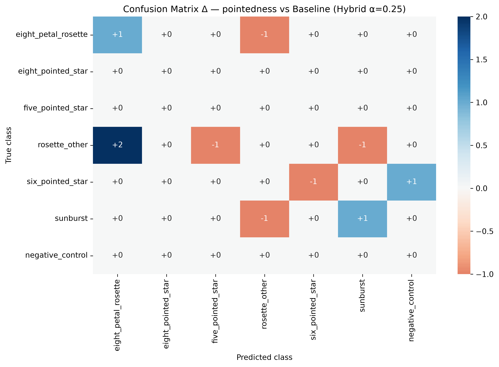

# v0.2 — Experiment 03: Pointedness (Radial Peak Width)

## 1. Objective and Experimental Setup

### Objective

Evaluate whether adding a **radial peak-width descriptor** improves fine-grained retrieval and discrimination of geometrically related motifs, particularly pointed stars, rosettes, and sunbursts.

### Experimental Hypothesis

The angular width of radial peaks provides complementary geometric information that may help distinguish narrow, pointed rays from broader or rounded petals.

### Feature Modification

Introduced `compute_radial_peak_width_features()`, which:

- Maps contour radii to a uniform 360-bin angular signal.
- Applies Gaussian smoothing to reduce contour noise.
- Detects radial peaks using prominence-based filtering.
- Computes the average peak width at half-prominence (`rel_height=0.5`).
- Normalizes the resulting width by 360.

Smaller values represent narrower radial peaks, while larger values indicate broader peaks.

The descriptor is enabled through `FEATURE_SET["pointedness"]`.

### Evaluation Protocol

The experiment follows the same evaluation protocol as the [v0.2 Development Baseline](../../v0.2_dev_baseline/evaluation.md):

- **Dataset:** Expanded v0.2 related-motif dataset.
- **Development partition:** 251 source artifacts, with 287 successfully extracted crops.
- **Queries:** 237 motif crops across six target classes.
- **Cross-validation:** Five stratified, artifact-grouped folds to prevent source-artifact leakage.
- **Held-out test:** 74 crops remain excluded from development evaluation.
- **Retrieval configurations:** DINOv2 (α=0.0), Hybrid (α ∈ {0.25, 0.50, 0.75}), and geometry-only (α=1.0).
- **Class voting:** Top-1 (K=1), majority voting, and similarity-weighted voting (K ∈ {3, 5, 7}), with artifact deduplication.

All comparisons use the frozen v0.2 development baseline to isolate the contribution of radial peak width.

## 2. Retrieval Performance Comparison

Results are reported as **mean ± standard deviation across five cross-validation folds**. Δ represents Pointedness − Baseline, calculated from unrounded means; positive values indicate improvement.

### 2.1 Overall Multi-Class Retrieval

| α | Metric | Baseline (Mean ± SD) | Pointedness (Mean ± SD) | Δ |
|---|---|---:|---:|---:|
| 0.00 | Hit@1 | 0.604 ± 0.064 | 0.604 ± 0.064 | +0.0000 |
| | Hit@5 | 0.877 ± 0.019 | 0.877 ± 0.019 | +0.0000 |
| | MRR | 0.720 ± 0.040 | 0.720 ± 0.040 | +0.0000 |
| 0.25 | Hit@1 | 0.606 ± 0.037 | 0.610 ± 0.038 | +0.0045 |
| | Hit@5 | 0.872 ± 0.043 | 0.880 ± 0.048 | +0.0083 |
| | MRR | 0.719 ± 0.036 | 0.722 ± 0.035 | +0.0028 |
| 0.50 | Hit@1 | 0.498 ± 0.075 | 0.506 ± 0.072 | +0.0080 |
| | Hit@5 | 0.891 ± 0.039 | 0.917 ± 0.033 | +0.0258 |
| | MRR | 0.665 ± 0.055 | 0.670 ± 0.049 | +0.0044 |
| 0.75 | Hit@1 | 0.354 ± 0.110 | 0.371 ± 0.102 | +0.0165 |
| | Hit@5 | 0.779 ± 0.077 | 0.782 ± 0.075 | +0.0037 |
| | MRR | 0.538 ± 0.087 | 0.547 ± 0.081 | +0.0083 |
| 1.00 | Hit@1 | 0.267 ± 0.096 | 0.282 ± 0.060 | +0.0158 |
| | Hit@5 | 0.648 ± 0.085 | 0.663 ± 0.069 | +0.0150 |
| | MRR | 0.442 ± 0.079 | 0.450 ± 0.055 | +0.0074 |

*Δ values are computed from unrounded means.*

**Observations:**

- **DINOv2 (α=0.0):** Results remain unchanged, as expected.
- **Hybrid (α=0.25):** Small

## 3. Multi-Class Discrimination Analysis

This section compares **pooled Top-1 predictions across all five folds (237 queries)** for Hybrid α=0.25. The pooled per-class metrics are distinct from the fold-averaged retrieval and voting metrics.

### 3.1 Per-Class Performance Comparison

| Motif class | Support | Baseline F1 | Pointedness F1 | Δ F1 |
|---|---:|---:|---:|---:|
| eight_petal_rosette | 34 | 0.6567 | 0.6571 | +0.0004 |
| eight_pointed_star | 52 | 0.6555 | 0.6555 | +0.0000 |
| five_pointed_star | 42 | 0.5783 | 0.5854 | +0.0071 |
| rosette_other | 31 | 0.6000 | 0.6207 | +0.0207 |
| six_pointed_star | 41 | 0.5263 | 0.5067 | −0.0196 |
| sunburst | 37 | 0.6774 | 0.7097 | +0.0323 |

*Δ F1 = Pointedness − Baseline, calculated from unrounded values.*

**Observations:**

- **Eight-pointed star:** No change in precision, recall, or F1, indicating no measurable aggregate Top-1 discrimination improvement for the primary target class.
- **Rosette motifs:** `eight_petal_rosette` gains recall (+0.0294) but loses precision (−0.0278), leaving F1 nearly unchanged. `rosette_other` improves F1 by 0.0207.
- **Other star classes:** `five_pointed_star` shows a minor F1 improvement (+0.0071), while `six_pointed_star` regresses (−0.0196), primarily due to reduced recall.
- **Sunburst:** The largest F1 improvement (+0.0323), suggesting that radial peak width may provide useful information for discriminating certain radial structures.

Overall, pointedness produces **small, class-dependent changes** without consistently improving star-class discrimination.

## 4. Confusion Pattern Analysis

The confusion-matrix difference is **Pointedness − Baseline** for Hybrid Top-1 (α=0.25). Positive diagonal values indicate additional correct predictions, while negative off-diagonal values indicate fewer misclassifications of the corresponding type.

### 4.1 Confusion Matrix Difference

### 4.2 Key Observations

- **Eight-pointed stars:** No net changes in the confusion-matrix row, indicating that pointedness does not alter the aggregate classification outcomes for the primary target class.
- **Eight-petal rosettes:** One additional correct prediction, previously assigned to `rosette_other`. However, two `rosette_other` queries are additionally assigned to `eight_petal_rosette`, explaining the recall improvement accompanied by lower precision.
- **Sunburst:** One additional correct prediction, previously confused with `rosette_other`, consistent with the observed F1 improvement.
- **Six-pointed stars:** One previously correct prediction is reassigned to `negative_control`, resulting in a small regression. Other prediction changes redistribute errors without improving correct classification.

Negative controls are retrieval candidates but not evaluation queries, explaining the all-zero `negative_control` row.

### 4.3 Confusion Assessment

The confusion-matrix delta shows **one net additional correct Top-1 prediction** across 237 queries.

Radial peak width improves selected rosette and sunburst predictions but does not resolve the central eight-pointed-star discrimination challenge. The observed changes primarily reflect a redistribution of classification errors rather than a systematic improvement across motif categories.

These findings support retaining pointedness as a candidate feature for combined-feature experiments, but do not establish its standalone effectiveness for fine-grained star-versus-rosette discrimination.

## 5. Class Voting Performance Comparison

This section compares baseline and pointedness-augmented class voting using artifact-deduplicated Top-K retrieval. The analysis focuses on Hybrid α=0.25.

Results are reported as **mean ± standard deviation across five cross-validation folds**. Δ represents Pointedness − Baseline, calculated from unrounded means.

### 5.1 Hybrid Voting Performance (α=0.25)

| Strategy | K | Baseline Accuracy | Pointedness Accuracy | Δ Accuracy | Baseline Macro F1 | Pointedness Macro F1 | Δ Macro F1 |
|---|---:|---:|---:|---:|---:|---:|---:|
| Top-1 | 1 | 0.6058 ± 0.0374 | 0.6102 ± 0.0383 | +0.0045 | 0.6089 ± 0.0358 | 0.6193 ± 0.0327 | +0.0104 |
| Majority | 3 | 0.5944 ± 0.0559 | 0.6026 ± 0.0708 | +0.0082 | 0.5913 ± 0.0581 | 0.6045 ± 0.0703 | +0.0133 |
| Majority | 5 | 0.6076 ± 0.0131 | 0.6114 ± 0.0247 | +0.0038 | 0.6067 ± 0.0217 | 0.6099 ± 0.0265 | +0.0032 |
| Majority | 7 | 0.6187 ± 0.0447 | 0.6222 ± 0.0537 | +0.0035 | 0.6184 ± 0.0467 | 0.6180 ± 0.0510 | −0.0004 |
| Weighted | 3 | 0.5944 ± 0.0559 | 0.6026 ± 0.0708 | +0.0082 | 0.5913 ± 0.0581 | 0.6045 ± 0.0703 | +0.0133 |
| Weighted | 5 | 0.6076 ± 0.0131 | 0.6032 ± 0.0214 | −0.0044 | 0.6067 ± 0.0217 | 0.6010 ± 0.0266 | −0.0057 |
| Weighted | 7 | 0.6185 ± 0.0443 | 0.6220 ± 0.0588 | +0.0035 | 0.6214 ± 0.0425 | 0.6210 ± 0.0538 | −0.0003 |

*Δ values are computed from unrounded means.*

**Key observations:**

- **Top-1 performance:** Accuracy improves slightly (+0.0045), while Macro F1 increases by 0.0104.
- **Neighborhood voting:** Majority and weighted K=3 show the largest relative Macro F1 improvement (+0.0133), but their absolute performance remains below Top-1.
- **Best experimental accuracy:** Majority K=7 achieves 0.6222, a small improvement over its baseline (+0.0035).
- **Best experimental Macro F1:** Weighted K=7 achieves 0.6210, slightly below its baseline of 0.6214.
- **Voting consistency:** Improvements are strategy-dependent, with small regressions in Weighted K=5 and Macro F1 at K=7.

### 5.2 Voting Performance Assessment

Pointedness produces modest, inconsistent improvements across voting configurations.

Although Top-1 Macro F1 increases and some neighborhood voting strategies benefit, the feature does not improve the strongest baseline Macro F1.

The results do not demonstrate a systematic advantage from neighborhood aggregation. More detailed voting-transition analysis is deferred unless combined-feature experiments reveal stronger effects.

## 6. Key Findings and Interpretation

1. **Retrieval improvements are modest but predominantly positive.** Radial peak width improves overall retrieval across nonzero geometric weights, with the largest gain in Hit@5 at α=0.50 (+0.0258). Improvements in Hit@1 and MRR remain small.

2. **Eight-pointed-star Top-1 discrimination remains unchanged.** For the primary target class, Hybrid Hit@1 does not improve at α=0.25–0.75, despite consistent Hit@5 gains of 0.0200. The descriptor improves candidate retrieval without clearly improving first-ranked predictions.

3. **Multi-class effects are class-dependent.** Sunburst and `rosette_other` show the largest F1 improvements (+0.0323 and +0.0207), while `six_pointed_star` regresses (−0.0196). The confusion-matrix delta shows only one net additional correct Top-1 prediction across 237 queries.

4. **Voting provides no consistent additional benefit.** Some configurations improve slightly, particularly K=3 voting, but the strongest baseline Macro F1 is not exceeded. Pointedness does not demonstrate a clear advantage through neighborhood aggregation.

### Limitations

These findings are exploratory development-set results from five artifact-grouped cross-validation folds. Multiple configurations were examined, and the observed improvements have not been established as statistically significant. The held-out test partition remains untouched.

**Overall assessment:** Radial peak width provides limited but potentially complementary geometric information, primarily improving Top-5 retrieval rather than fine-grained Top-1 discrimination.
The initial hypothesis is **not supported for Hybrid Top-1 eight-pointed-star discrimination** and is **partially supported for Top-5 retrieval**, with class-dependent effects on multi-class performance.
Unlike a direct tip-curvature descriptor, radial peak width captures the angular breadth of radial peaks and may therefore contribute differently when combined with other geometric features.

**Decision:** Retain pointedness as a candidate for Phase B combined-feature ablations, but do not select it as a standalone improvement for the final v0.2 configuration.
