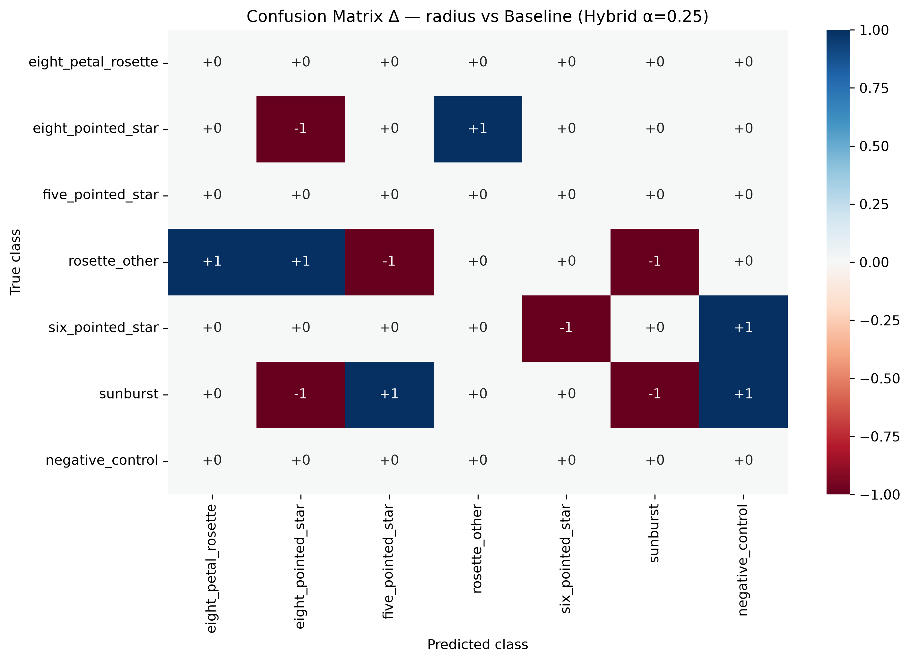

# v0.2 — Experiment 04: Radius (Radial Valley Depth)

## 1. Objective and Experimental Setup

### Objective

Evaluate whether adding a **radial radius-ratio descriptor** improves fine-grained retrieval and discrimination of geometrically related motifs, particularly stars, rosettes, and sunbursts with different degrees of radial indentation.

### Experimental Hypothesis

The relative depth of valleys between radial peaks provides complementary geometric information that may help distinguish deeply indented star shapes from motifs with shallower radial structures, such as certain rosettes.

### Feature Modification

Introduced `compute_radius_features()`, which:

- Maps contour radii to a uniform 360-bin angular signal.
- Applies Gaussian smoothing to reduce contour noise.
- Detects radial peaks (outer radii) and valleys (inner radii) using prominence-based filtering.
- Computes the ratio between median valley radius and median peak radius.

The descriptor is defined as:

\[
\text{radius ratio} = \frac{\text{median valley radius}}{\text{median peak radius}}
\]

Lower values indicate deeper radial indentations, while values closer to 1.0 indicate shallower indentations or approximately circular shapes.

The descriptor is enabled through `FEATURE_SET["radius"]`.

### Evaluation Protocol

The experiment follows the same evaluation protocol as the [v0.2 Development Baseline](../../v0.2_dev_baseline/evaluation.md):

- **Dataset:** Expanded v0.2 related-motif dataset.
- **Development partition:** 251 source artifacts, with 287 successfully extracted crops.
- **Queries:** 237 motif crops across six target classes.
- **Cross-validation:** Five stratified, artifact-grouped folds to prevent source-artifact leakage.
- **Held-out test:** 74 crops remain excluded from development evaluation.
- **Retrieval configurations:** DINOv2 (α=0.0), Hybrid (α ∈ {0.25, 0.50, 0.75}), and geometry-only (α=1.0).
- **Class voting:** Top-1 (K=1), majority voting, and similarity-weighted voting (K ∈ {3, 5, 7}), with artifact deduplication.

All comparisons use the frozen v0.2 development baseline to isolate the contribution of the radial radius-ratio descriptor.

## 2. Retrieval Performance Comparison

Results are reported as **mean ± standard deviation across five cross-validation folds**. Δ represents Radius − Baseline, calculated from unrounded means; positive values indicate improvement.

### 2.1 Overall Multi-Class Retrieval

| α | Metric | Baseline (Mean ± SD) | Radius (Mean ± SD) | Δ |
|---|---|---:|---:|---:|
| 0.00 | Hit@1 | 0.604 ± 0.064 | 0.604 ± 0.064 | +0.0000 |
| | Hit@5 | 0.877 ± 0.019 | 0.877 ± 0.019 | +0.0000 |
| | MRR | 0.720 ± 0.040 | 0.720 ± 0.040 | +0.0000 |
| 0.25 | Hit@1 | 0.606 ± 0.037 | 0.593 ± 0.042 | −0.0128 |
| | Hit@5 | 0.872 ± 0.043 | 0.875 ± 0.064 | +0.0030 |
| | MRR | 0.719 ± 0.036 | 0.717 ± 0.038 | −0.0024 |
| 0.50 | Hit@1 | 0.498 ± 0.075 | 0.501 ± 0.088 | +0.0034 |
| | Hit@5 | 0.891 ± 0.039 | 0.874 ± 0.042 | −0.0170 |
| | MRR | 0.665 ± 0.055 | 0.666 ± 0.062 | +0.0007 |
| 0.75 | Hit@1 | 0.354 ± 0.110 | 0.348 ± 0.091 | −0.0060 |
| | Hit@5 | 0.779 ± 0.077 | 0.788 ± 0.060 | +0.0091 |
| | MRR | 0.538 ± 0.087 | 0.539 ± 0.069 | +0.0003 |
| 1.00 | Hit@1 | 0.267 ± 0.096 | 0.292 ± 0.087 | +0.0252 |
| | Hit@5 | 0.648 ± 0.085 | 0.650 ± 0.066 | +0.0023 |
| | MRR | 0.442 ± 0.079 | 0.459 ± 0.071 | +0.0171 |

*Δ values are computed from unrounded means.*

**Observations:**

- **DINOv2 (α=0.0):** Results remain unchanged, as expected.
- **Hybrid (α=0.25):** Hit@1 decreases by 0.0128, while Hit@5 improves marginally (+0.0030) and MRR decreases slightly.
- **Hybrid (α=0.50–0.75):** Mixed results, with small changes in Hit@1 and MRR. Hit@5 decreases at α=0.50 (−0.0170) but improves at α=0.75 (+0.0091).
- **Geometry-only (α=1.0):** Hit@1 improves by 0.0252 and MRR by 0.0171, although absolute performance remains substantially below DINOv2-only retrieval.

Overall, the radius descriptor produces **mixed retrieval effects**, without consistent improvements across hybrid configurations. The strongest overall Hit@1 gain occurs in geometry-only retrieval, but this does not translate into improved performance at the primary Hybrid α=0.25 configuration.

### 2.2 Target-Class Retrieval: `eight_pointed_star` (52 Queries)

| α | Metric | Baseline (Mean ± SD) | Radius (Mean ± SD) | Δ |
|---|---|---:|---:|---:|
| 0.00 | Hit@1 | 0.753 ± 0.059 | 0.753 ± 0.059 | +0.0000 |
| | Hit@5 | 0.960 ± 0.049 | 0.960 ± 0.049 | +0.0000 |
| | MRR | 0.829 ± 0.044 | 0.829 ± 0.044 | +0.0000 |
| 0.25 | Hit@1 | 0.746 ± 0.086 | 0.728 ± 0.078 | −0.0182 |
| | Hit@5 | 0.938 ± 0.051 | 0.958 ± 0.052 | +0.0200 |
| | MRR | 0.834 ± 0.075 | 0.830 ± 0.065 | −0.0041 |
| 0.50 | Hit@1 | 0.667 ± 0.076 | 0.668 ± 0.067 | +0.0018 |
| | Hit@5 | 0.960 ± 0.080 | 0.980 ± 0.040 | +0.0200 |
| | MRR | 0.787 ± 0.056 | 0.801 ± 0.050 | +0.0143 |
| 0.75 | Hit@1 | 0.458 ± 0.118 | 0.478 ± 0.096 | +0.0200 |
| | Hit@5 | 0.825 ± 0.076 | 0.879 ± 0.081 | +0.0541 |
| | MRR | 0.623 ± 0.079 | 0.658 ± 0.063 | +0.0353 |
| 1.00 | Hit@1 | 0.363 ± 0.043 | 0.332 ± 0.090 | −0.0308 |
| | Hit@5 | 0.684 ± 0.119 | 0.722 ± 0.106 | +0.0382 |
| | MRR | 0.522 ± 0.049 | 0.517 ± 0.083 | −0.0046 |

*Δ values are computed from unrounded means.*

**Observations:**

- **Hybrid (α=0.25):** Hit@1 decreases by 0.0182, while Hit@5 improves by 0.0200. MRR decreases slightly, indicating no improvement in first-ranked retrieval.
- **Hybrid (α=0.50):** Hit@5 reaches 0.9800 (+0.0200), with a modest MRR improvement (+0.0143) and nearly unchanged Hit@1.
- **Hybrid (α=0.75):** The strongest target-class improvements occur here, with Hit@5 increasing by 0.0541 and MRR by 0.0353. However, absolute Hit@1 remains relatively low (0.4783).
- **Geometry-only (α=1.0):** Hit@5 improves by 0.0382, but Hit@1 decreases by 0.0308, indicating inconsistent ranking benefits.

For the primary eight-pointed-star class, the radius descriptor improves Hit@5 across all nonzero geometric weights, but its effect on Hit@1 and MRR varies substantially.

### 2.3 Retrieval Assessment

The radial radius-ratio descriptor provides **mixed overall retrieval performance but potentially useful improvements in eight-pointed-star candidate retrieval**.

At the primary Hybrid α=0.25 configuration, overall Hit@1 decreases by 0.0128 and target Hit@1 decreases by 0.0182, despite a 0.0200 improvement in target Hit@5.

Higher geometric weights produce stronger target-class Hit@5 gains, particularly at α=0.75 (+0.0541), but do not establish consistent Top-1 improvements.

These results suggest that relative radial indentation depth can influence candidate rankings, but its standalone contribution to fine-grained discrimination remains uncertain.

Further per-class confusion and neighborhood-voting analysis is needed to determine whether the additional retrieved candidates contribute to more accurate motif classification.

## 3. Multi-Class Discrimination Analysis

This section compares **pooled Top-1 predictions across all five folds (237 queries)** for Hybrid α=0.25. The pooled per-class metrics are distinct from the fold-averaged retrieval and voting metrics.

### 3.1 Per-Class Performance Comparison

| Motif class | Support | Baseline F1 | Radius F1 | Δ F1 |
|---|---:|---:|---:|---:|
| eight_petal_rosette | 34 | 0.6567 | 0.6471 | −0.0097 |
| eight_pointed_star | 52 | 0.6555 | 0.6441 | −0.0114 |
| five_pointed_star | 42 | 0.5783 | 0.5783 | +0.0000 |
| rosette_other | 31 | 0.6000 | 0.5902 | −0.0098 |
| six_pointed_star | 41 | 0.5263 | 0.5067 | −0.0196 |
| sunburst | 37 | 0.6774 | 0.6667 | −0.0108 |

*Δ F1 = Radius − Baseline, calculated from unrounded values.*

**Observations:**

- **Eight-pointed star:** Recall decreases from 0.7500 to 0.7308, with F1 declining by 0.0114, indicating weaker Top-1 discrimination for the primary target class.
- **Rosette motifs:** `eight_petal_rosette` and `rosette_other` show F1 decreases of 0.0097 and 0.0098, respectively, primarily due to reduced precision.
- **Other star classes:** `five_pointed_star` remains unchanged, while `six_pointed_star` exhibits the largest F1 regression (−0.0196), driven by reduced recall.
- **Sunburst:** Precision improves slightly (+0.0296), but recall decreases (−0.0270), resulting in a lower F1 (−0.0108).

Overall, radius augmentation produces **small but consistently non-positive F1 changes** across all six motif classes. No class demonstrates improved Top-1 F1 at Hybrid α=0.25.

## 4. Confusion Pattern Analysis

The confusion-matrix difference is **Radius − Baseline** for Hybrid Top-1 (α=0.25). Positive diagonal values indicate additional correct predictions, while negative off-diagonal values indicate fewer misclassifications of the corresponding type.

### 4.1 Confusion Matrix Difference

### 4.2 Key Observations

- **Eight-pointed stars:** One previously correct prediction is reassigned to `rosette_other`, reducing target-class recall. No improvement is observed in direct eight-pointed-star versus eight-petal-rosette discrimination.
- **Rosette motifs:** The `eight_petal_rosette` row remains unchanged, while `rosette_other` predictions are redistributed toward `eight_petal_rosette` and `eight_pointed_star`. These changes increase false-positive assignments without improving rosette classification.
- **Six-pointed stars:** One previously correct prediction is reassigned to `negative_control`, contributing to the largest per-class F1 regression.
- **Sunburst:** One previously correct prediction becomes incorrect, while other errors are redistributed among `five_pointed_star`, `eight_pointed_star`, and `negative_control`. Precision increases, but recall and F1 decline.

Negative controls are retrieval candidates but not evaluation queries, explaining the all-zero `negative_control` row.

### 4.3 Confusion Assessment

The confusion-matrix delta shows **three fewer correct Top-1 predictions** across 237 queries.

Radius augmentation does not improve correct classification for any motif class at Hybrid α=0.25. Instead, the observed changes primarily redistribute errors, including additional misclassifications of star and sunburst motifs as negative controls.

These findings indicate that relative radial indentation depth does not provide a standalone improvement in fine-grained Top-1 discrimination under the evaluated configuration.

However, the target-class Hit@5 improvements observed in Section 2 suggest that the descriptor may still influence neighborhood composition in ways that could benefit Top-K class voting. This possibility is examined in Section 5.

## 5. Class Voting Performance Comparison

This section compares baseline and radius-augmented class voting using artifact-deduplicated Top-K retrieval. The analysis focuses on Hybrid α=0.25.

Results are reported as **mean ± standard deviation across five cross-validation folds**. Δ represents Radius − Baseline, calculated from unrounded means.

### 5.1 Hybrid Voting Performance (α=0.25)

| Strategy | K | Baseline Accuracy | Radius Accuracy | Δ Accuracy | Baseline Macro F1 | Radius Macro F1 | Δ Macro F1 |
|---|---:|---:|---:|---:|---:|---:|---:|
| Top-1 | 1 | 0.6058 ± 0.0374 | 0.5929 ± 0.0415 | −0.0128 | 0.6089 ± 0.0358 | 0.5984 ± 0.0414 | −0.0105 |
| Majority | 3 | 0.5944 ± 0.0559 | 0.6162 ± 0.0679 | +0.0217 | 0.5913 ± 0.0581 | 0.6142 ± 0.0742 | +0.0230 |
| Majority | 5 | 0.6076 ± 0.0131 | 0.6195 ± 0.0240 | +0.0120 | 0.6067 ± 0.0217 | 0.6169 ± 0.0255 | +0.0102 |
| Majority | 7 | 0.6187 ± 0.0447 | 0.6228 ± 0.0420 | +0.0042 | 0.6184 ± 0.0467 | 0.6210 ± 0.0411 | +0.0027 |
| Weighted | 3 | 0.5944 ± 0.0559 | 0.6162 ± 0.0679 | +0.0217 | 0.5913 ± 0.0581 | 0.6142 ± 0.0742 | +0.0230 |
| Weighted | 5 | 0.6076 ± 0.0131 | 0.6152 ± 0.0273 | +0.0076 | 0.6067 ± 0.0217 | 0.6108 ± 0.0349 | +0.0041 |
| Weighted | 7 | 0.6185 ± 0.0443 | 0.6228 ± 0.0420 | +0.0043 | 0.6214 ± 0.0425 | 0.6221 ± 0.0403 | +0.0008 |

*Δ values are computed from unrounded means.*

**Key observations:**

- **Top-1 performance:** Accuracy decreases by 0.0128 and Macro F1 by 0.0105, consistent with the observed multi-class discrimination regressions.
- **Neighborhood voting:** All evaluated majority and weighted voting configurations improve over their corresponding baselines, despite weaker Top-1 performance.
- **Largest relative improvement:** Both Majority and Weighted K=3 increase accuracy by 0.0217 and Macro F1 by 0.0230.
- **Best experimental configuration:** Weighted K=7 achieves the highest Macro F1 (0.6221), but improves only marginally over its baseline (0.6214).
- **Neighborhood size:** Relative gains generally decrease as K increases, suggesting that the descriptor's contribution may be more pronounced in smaller retrieval neighborhoods.

### 5.2 Voting Performance Assessment

Radius augmentation improves neighborhood voting despite reducing Top-1 classification performance.

The strongest relative improvement occurs at K=3, suggesting that changes in nearest-neighbor composition or ranking may benefit class aggregation. However, the underlying mechanism remains unverified without per-query or neighbor-level analysis.

Although voting improvements are consistently positive, the strongest baseline Macro F1 is only marginally exceeded.

**Assessment:** Radius shows greater promise through neighborhood voting than Top-1 discrimination, but its standalone contribution remains limited and requires further validation.

## 6. Key Findings and Interpretation

1. **Overall retrieval performance is mixed.** Radius augmentation produces small and inconsistent changes across hybrid configurations. At α=0.25, overall Hit@1 decreases by 0.0128, while geometry-only Hit@1 improves by 0.0252 but remains substantially below DINOv2-only performance.

2. **Eight-pointed-star candidate retrieval improves, but Top-1 discrimination does not.** Target Hit@5 increases across all nonzero geometric weights, with the largest gain at α=0.75 (+0.0541). However, at the primary Hybrid α=0.25 configuration, target Hit@1 decreases by 0.0182.

3. **Fine-grained Top-1 discrimination deteriorates.** Five of six motif classes exhibit F1 decreases, while `five_pointed_star` remains unchanged. The confusion-matrix delta shows three fewer correct predictions across 237 queries, including additional star and sunburst misclassifications as negative controls.

4. **Neighborhood voting provides consistent but limited improvements.** All evaluated Hybrid voting configurations improve relative to their corresponding baselines. K=3 yields the largest relative Macro F1 improvement (+0.0230), while the best absolute Macro F1 increases only marginally under Weighted K=7 (+0.0008). The mechanism behind these gains remains unverified.

### Limitations

These findings are exploratory development-set results from five artifact-grouped cross-validation folds. Multiple configurations were examined, and the observed improvements have not been established as statistically significant. The held-out test partition remains untouched.

**Overall assessment:** The radial radius-ratio descriptor provides mixed retrieval performance, with improvements in eight-pointed-star Top-5 candidate retrieval and neighborhood voting, but weaker fine-grained Top-1 discrimination.
The initial hypothesis is **not supported for Hybrid Top-1 fine-grained discrimination** and is **partially supported for target-class Top-5 retrieval and neighborhood voting**, with improvements dependent on geometric weighting and voting configuration.
Radius captures relative radial indentation depth, a geometric property distinct from the angular peak breadth measured by pointedness. Its potential complementary value remains to be evaluated in combined-feature experiments.

**Decision:** Retain radius as a candidate for Phase B combined-feature ablations, but do not select it as a standalone improvement for the final v0.2 configuration.
