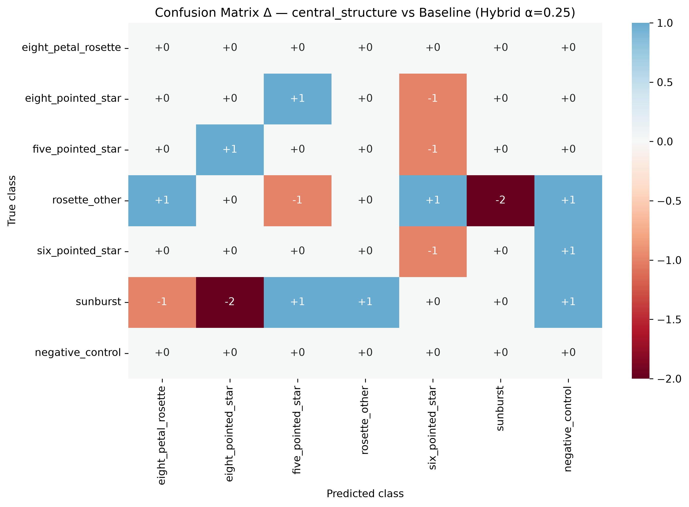

# v0.2 — Experiment 05: Central Structure (Central Edge Density)

## 1. Objective and Experimental Setup

### Objective

Evaluate whether adding a **central edge-density descriptor** improves fine-grained retrieval and discrimination of geometrically related motifs, particularly stars and rosettes with different internal structures.

### Experimental Hypothesis

The density of internal edges within the central region of a motif provides complementary structural information that may help distinguish rosettes with prominent central rings, disks, or decorative elements from stars with simpler central structures.

### Feature Modification

Introduced `compute_central_structure_features()`, which:

- Defines a circular central region extending to 30% of the motif's maximum contour radius.
- Computes the number of edge pixels within the central region.
- Normalizes the edge count by the total number of pixels in the central region.

The descriptor is defined as:

\[
\text{central density} = \frac{\text{edge pixels within central region}}{\text{total pixels within central region}}
\]

Higher values indicate greater internal edge density, while lower values indicate fewer detected edges within the central region.

The descriptor is enabled through `FEATURE_SET["central_structure"]`.

### Evaluation Protocol

The experiment follows the same evaluation protocol as the [v0.2 Development Baseline](../../v0.2_dev_baseline/evaluation.md):

- **Dataset:** Expanded v0.2 related-motif dataset.
- **Development partition:** 251 source artifacts, with 287 successfully extracted crops.
- **Queries:** 237 motif crops across six target classes.
- **Cross-validation:** Five stratified, artifact-grouped folds to prevent source-artifact leakage.
- **Held-out test:** 74 crops remain excluded from development evaluation.
- **Retrieval configurations:** DINOv2 (α=0.0), Hybrid (α ∈ {0.25, 0.50, 0.75}), and geometry-only (α=1.0).
- **Class voting:** Top-1 (K=1), majority voting, and similarity-weighted voting (K ∈ {3, 5, 7}), with artifact deduplication.

All comparisons use the frozen v0.2 development baseline to isolate the contribution of the central edge-density descriptor.

## 2. Retrieval Performance Comparison

Results are reported as **mean ± standard deviation across five cross-validation folds**. Δ represents Central Structure − Baseline, calculated from unrounded means; positive values indicate improvement.

### 2.1 Overall Multi-Class Retrieval

| α | Metric | Baseline (Mean ± SD) | Central Structure (Mean ± SD) | Δ |
|---|---|---:|---:|---:|
| 0.00 | Hit@1 | 0.604 ± 0.064 | 0.604 ± 0.064 | +0.0000 |
| | Hit@5 | 0.877 ± 0.019 | 0.877 ± 0.019 | +0.0000 |
| | MRR | 0.720 ± 0.040 | 0.720 ± 0.040 | +0.0000 |
| 0.25 | Hit@1 | 0.606 ± 0.037 | 0.602 ± 0.027 | −0.0034 |
| | Hit@5 | 0.872 ± 0.043 | 0.863 ± 0.046 | −0.0083 |
| | MRR | 0.719 ± 0.036 | 0.718 ± 0.027 | −0.0014 |
| 0.50 | Hit@1 | 0.498 ± 0.075 | 0.498 ± 0.086 | +0.0003 |
| | Hit@5 | 0.891 ± 0.039 | 0.879 ± 0.037 | −0.0120 |
| | MRR | 0.665 ± 0.055 | 0.659 ± 0.067 | −0.0064 |
| 0.75 | Hit@1 | 0.354 ± 0.110 | 0.368 ± 0.096 | +0.0134 |
| | Hit@5 | 0.779 ± 0.077 | 0.784 ± 0.086 | +0.0051 |
| | MRR | 0.538 ± 0.087 | 0.543 ± 0.082 | +0.0049 |
| 1.00 | Hit@1 | 0.267 ± 0.096 | 0.248 ± 0.074 | −0.0183 |
| | Hit@5 | 0.648 ± 0.085 | 0.660 ± 0.095 | +0.0125 |
| | MRR | 0.442 ± 0.079 | 0.430 ± 0.071 | −0.0127 |

*Δ values are computed from unrounded means.*

**Observations:**

- **DINOv2 (α=0.0):** Results remain unchanged, as expected.
- **Hybrid (α=0.25):** All retrieval metrics decrease slightly, with Hit@1 declining by 0.0034 and Hit@5 by 0.0083.
- **Hybrid (α=0.50–0.75):** Mixed results. At α=0.50, Hit@1 remains effectively unchanged while Hit@5 and MRR decline. At α=0.75, all three metrics improve modestly.
- **Geometry-only (α=1.0):** Hit@5 improves by 0.0125, but Hit@1 and MRR decrease by 0.0183 and 0.0127, respectively.

Overall, central edge density produces **inconsistent retrieval effects**, with no systematic improvement across hybrid configurations. At the primary Hybrid α=0.25 configuration, all three retrieval metrics deteriorate slightly.

### 2.2 Target-Class Retrieval: `eight_pointed_star` (52 Queries)

| α | Metric | Baseline (Mean ± SD) | Central Structure (Mean ± SD) | Δ |
|---|---|---:|---:|---:|
| 0.00 | Hit@1 | 0.753 ± 0.059 | 0.753 ± 0.059 | +0.0000 |
| | Hit@5 | 0.960 ± 0.049 | 0.960 ± 0.049 | +0.0000 |
| | MRR | 0.829 ± 0.044 | 0.829 ± 0.044 | +0.0000 |
| 0.25 | Hit@1 | 0.746 ± 0.086 | 0.746 ± 0.086 | +0.0000 |
| | Hit@5 | 0.938 ± 0.051 | 0.938 ± 0.051 | +0.0000 |
| | MRR | 0.834 ± 0.075 | 0.830 ± 0.070 | −0.0043 |
| 0.50 | Hit@1 | 0.667 ± 0.076 | 0.685 ± 0.096 | +0.0182 |
| | Hit@5 | 0.960 ± 0.080 | 0.980 ± 0.040 | +0.0200 |
| | MRR | 0.787 ± 0.056 | 0.799 ± 0.062 | +0.0121 |
| 0.75 | Hit@1 | 0.458 ± 0.118 | 0.475 ± 0.139 | +0.0167 |
| | Hit@5 | 0.825 ± 0.076 | 0.861 ± 0.103 | +0.0364 |
| | MRR | 0.623 ± 0.079 | 0.649 ± 0.088 | +0.0256 |
| 1.00 | Hit@1 | 0.363 ± 0.043 | 0.306 ± 0.060 | −0.0571 |
| | Hit@5 | 0.684 ± 0.119 | 0.704 ± 0.111 | +0.0200 |
| | MRR | 0.522 ± 0.049 | 0.496 ± 0.055 | −0.0255 |

*Δ values are computed from unrounded means.*

**Observations:**

- **Hybrid (α=0.25):** Hit@1 and Hit@5 remain unchanged, while MRR decreases slightly (−0.0043), indicating no improvement in target-class retrieval.
- **Hybrid (α=0.50):** All three metrics improve. Hit@1 increases by 0.0182, Hit@5 reaches 0.9800 (+0.0200), and MRR improves by 0.0121.
- **Hybrid (α=0.75):** Target retrieval improves across all metrics, with the largest Hit@5 gain (+0.0364). However, absolute Hit@1 remains relatively low (0.4749).
- **Geometry-only (α=1.0):** Hit@5 improves by 0.0200, but Hit@1 decreases substantially (−0.0571), accompanied by a lower MRR (−0.0255).

For the primary eight-pointed-star class, central structure improves retrieval at intermediate geometric weights (α=0.50–0.75), but provides no benefit at α=0.25 and substantially reduces Top-1 performance in geometry-only retrieval.

### 2.3 Retrieval Assessment

Central edge density provides **limited standalone retrieval value**, with improvements concentrated in the eight-pointed-star target class at intermediate geometric weights.

At the primary Hybrid α=0.25 configuration, overall Hit@1 decreases by 0.0034, while target Hit@1 and Hit@5 remain unchanged.

At α=0.50–0.75, target-class retrieval improves across all metrics, suggesting that internal edge-density information can influence relevant candidate rankings when geometric features receive greater weight.

However, these gains do not translate into consistent overall retrieval improvements, and geometry-only performance deteriorates substantially for target Hit@1.

The results suggest that central edge density may provide some complementary information, but its standalone contribution to fine-grained motif discrimination remains uncertain.

Per-class discrimination and neighborhood-voting analyses are needed to determine whether the observed target-class retrieval gains improve classification performance.

## 3. Multi-Class Discrimination Analysis

This section compares **pooled Top-1 predictions across all five folds (237 queries)** for Hybrid α=0.25. The pooled per-class metrics are distinct from the fold-averaged retrieval and voting metrics.

### 3.1 Per-Class Performance Comparison

| Motif class | Support | Baseline F1 | Central Structure F1 | Δ F1 |
|---|---:|---:|---:|---:|
| eight_petal_rosette | 34 | 0.6567 | 0.6567 | +0.0000 |
| eight_pointed_star | 52 | 0.6555 | 0.6610 | +0.0056 |
| five_pointed_star | 42 | 0.5783 | 0.5714 | −0.0069 |
| rosette_other | 31 | 0.6000 | 0.5902 | −0.0098 |
| six_pointed_star | 41 | 0.5263 | 0.5135 | −0.0128 |
| sunburst | 37 | 0.6774 | 0.7000 | +0.0226 |

*Δ F1 = Central Structure − Baseline, calculated from unrounded values.*

**Observations:**

- **Eight-pointed star:** F1 improves slightly (+0.0056), driven by increased precision (+0.0088), while recall remains unchanged at 0.7500.
- **Rosette motifs:** `eight_petal_rosette` remains unchanged, while `rosette_other` shows a small F1 regression (−0.0098), indicating no improvement in rosette discrimination.
- **Other star classes:** `five_pointed_star` and `six_pointed_star` exhibit F1 decreases of 0.0069 and 0.0128, respectively. Six-pointed-star recall declines by 0.0244.
- **Sunburst:** The largest F1 improvement (+0.0226), driven by higher precision (+0.0730), without an increase in recall.

Overall, central structure produces **small, class-dependent changes**, with limited precision improvements for `eight_pointed_star` and `sunburst` but no consistent improvement in fine-grained Top-1 discrimination.

## 4. Confusion Pattern Analysis

The confusion-matrix difference is **Central Structure − Baseline** for Hybrid Top-1 (α=0.25). Positive diagonal values indicate additional correct predictions, while negative off-diagonal values indicate fewer misclassifications of the corresponding type.

### 4.1 Confusion Matrix Difference

### 4.2 Key Observations

- **Eight-pointed stars:** Correct predictions remain unchanged. One fewer query is misclassified as `six_pointed_star`, but one additional query is assigned to `five_pointed_star`. The small precision improvement results from fewer false-positive assignments from other classes, rather than improved target recall.
- **Rosette motifs:** The `eight_petal_rosette` row remains unchanged. For `rosette_other`, errors are redistributed across other classes, including fewer assignments to `sunburst` but additional assignments to `eight_petal_rosette`, `six_pointed_star`, and `negative_control`. Correct classification does not improve.
- **Sunburst:** Two fewer `rosette_other` queries are incorrectly assigned to `sunburst`, improving its precision. However, the number of correctly classified sunbursts remains unchanged.
- **Six-pointed stars and negative controls:** One previously correct `six_pointed_star` prediction is reassigned to `negative_control`. Overall, three additional queries are assigned to `negative_control`, indicating a potential weakness in distinguishing certain motif structures from negative examples.

Negative controls are retrieval candidates but not evaluation queries, explaining the all-zero `negative_control` row.

### 4.3 Confusion Assessment

The confusion-matrix delta shows **one net fewer correct Top-1 prediction** across 237 queries.

Central structure improves precision for selected classes, particularly `sunburst`, but does not improve correct classification of eight-pointed stars or rosettes.

The observed changes primarily redistribute classification errors rather than resolving the intended distinction between motifs with different internal structures.

These findings indicate that central edge density does not provide a consistent standalone improvement in fine-grained Top-1 discrimination at Hybrid α=0.25. Its potential value in neighborhood-based classification is examined in Section 5.

## 5. Class Voting Performance Comparison

This section compares baseline and central-structure-augmented class voting using artifact-deduplicated Top-K retrieval. The analysis focuses on Hybrid α=0.25.

Results are reported as **mean ± standard deviation across five cross-validation folds**. Δ represents Central Structure − Baseline, calculated from unrounded means.

### 5.1 Hybrid Voting Performance (α=0.25)

| Strategy | K | Baseline Accuracy | Central Structure Accuracy | Δ Accuracy | Baseline Macro F1 | Central Structure Macro F1 | Δ Macro F1 |
|---|---:|---:|---:|---:|---:|---:|---:|
| Top-1 | 1 | 0.6058 ± 0.0374 | 0.6024 ± 0.0267 | −0.0034 | 0.6089 ± 0.0358 | 0.6112 ± 0.0307 | +0.0023 |
| Majority | 3 | 0.5944 ± 0.0559 | 0.6000 ± 0.0618 | +0.0055 | 0.5913 ± 0.0581 | 0.5890 ± 0.0692 | −0.0022 |
| Majority | 5 | 0.6076 ± 0.0131 | 0.6082 ± 0.0264 | +0.0007 | 0.6067 ± 0.0217 | 0.6063 ± 0.0309 | −0.0004 |
| Majority | 7 | 0.6187 ± 0.0447 | 0.6139 ± 0.0605 | −0.0048 | 0.6184 ± 0.0467 | 0.6038 ± 0.0663 | −0.0146 |
| Weighted | 3 | 0.5944 ± 0.0559 | 0.6000 ± 0.0618 | +0.0055 | 0.5913 ± 0.0581 | 0.5890 ± 0.0692 | −0.0022 |
| Weighted | 5 | 0.6076 ± 0.0131 | 0.6037 ± 0.0229 | −0.0039 | 0.6067 ± 0.0217 | 0.6004 ± 0.0259 | −0.0063 |
| Weighted | 7 | 0.6185 ± 0.0443 | 0.6139 ± 0.0605 | −0.0046 | 0.6214 ± 0.0425 | 0.6038 ± 0.0663 | −0.0176 |

*Δ values are computed from unrounded means.*

**Key observations:**

- **Top-1 performance:** Accuracy decreases slightly (−0.0034), while Macro F1 improves marginally (+0.0023).
- **Neighborhood voting:** All evaluated majority and weighted voting configurations show negative Macro F1 changes, indicating no improvement in balanced multi-class classification.
- **K=3 voting:** Accuracy improves slightly (+0.0055), but Macro F1 decreases (−0.0022).
- **Larger neighborhoods:** More pronounced regressions occur at K=7, particularly Weighted K=7, where Macro F1 decreases from 0.6214 to 0.6038 (−0.0176).
- **Best experimental configuration:** Top-1 achieves the highest Macro F1 (0.6112) among the central-structure configurations, below the strongest baseline voting result (0.6214).

### 5.2 Voting Performance Assessment

Central structure augmentation does not provide consistent improvements in neighborhood voting at Hybrid α=0.25.

Although K=3 voting produces a small accuracy improvement, Macro F1 decreases slightly. Larger neighborhoods show more pronounced regressions, with Weighted K=7 exhibiting the largest Macro F1 decline (−0.0176).

These results suggest that central edge density does not improve class aggregation under the evaluated configurations.

**Assessment:** Central structure shows limited standalone value and no demonstrated advantage through neighborhood voting.

## 6. Key Findings and Interpretation

1. **Overall retrieval performance is inconsistent.** Central structure augmentation produces mixed effects across hybrid configurations. At α=0.25, overall Hit@1 decreases by 0.0034 and Hit@5 by 0.0083. Geometry-only Hit@1 also deteriorates (−0.0183).

2. **Eight-pointed-star retrieval improves only at intermediate geometric weights.** At α=0.50–0.75, target Hit@1, Hit@5, and MRR improve modestly. However, at the primary Hybrid α=0.25 configuration, target Hit@1 and Hit@5 remain unchanged, providing no evidence of improved first-ranked discrimination.

3. **Fine-grained Top-1 discrimination remains unresolved.** Central structure produces small precision-driven F1 improvements for `eight_pointed_star` (+0.0056) and `sunburst` (+0.0226), but no improvement for `eight_petal_rosette`. Three other classes regress, and the confusion-matrix delta shows one net fewer correct prediction across 237 queries.

4. **Neighborhood voting does not benefit from central structure augmentation.** All evaluated Hybrid voting configurations show negative Macro F1 changes. Weighted K=7 exhibits the largest regression (−0.0176), suggesting that the descriptor does not improve neighborhood-based class aggregation.

### Limitations

These findings are exploratory development-set results from five artifact-grouped cross-validation folds. Multiple configurations were examined, and the observed improvements have not been established as statistically significant. The held-out test partition remains untouched.

**Overall assessment:** Central edge density provides limited and inconsistent retrieval benefits, with modest improvements for eight-pointed-star retrieval at intermediate geometric weights but no demonstrated improvement in fine-grained Top-1 discrimination or neighborhood voting at α=0.25.
The initial hypothesis is **not supported for Hybrid Top-1 star-versus-rosette discrimination** and is **not supported for neighborhood voting**. Limited target-class retrieval improvements at higher geometric weights do not establish a consistent benefit.
Central edge density may capture internal engraving, texture, or segmentation artifacts rather than distinctive motif-center geometry, although this explanation has not been empirically verified.

**Decision:** Do not select central structure as a standalone improvement for the final v0.2 configuration. Deprioritize it in Phase B, retaining it only as an optional feature for testing potential interactions with other geometric descriptors.
