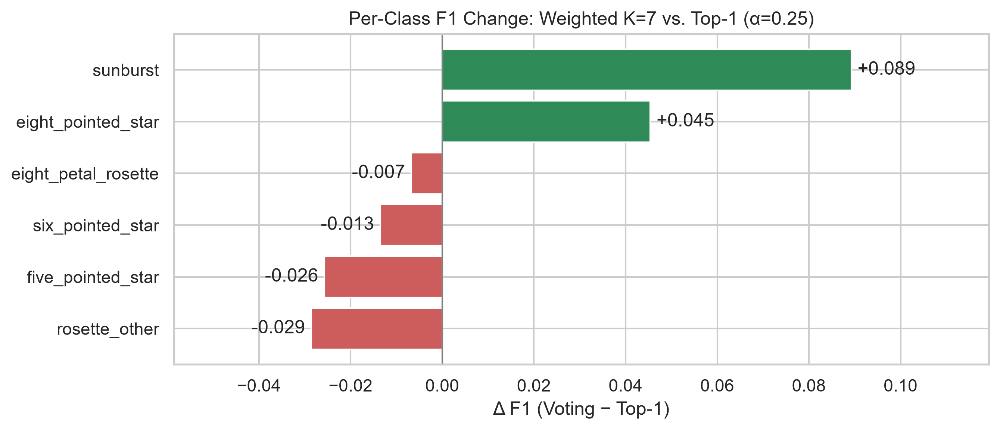

# v0.2 Class Voting Experiment Evaluation

## 1. Objective and Methodology

This evaluation assesses whether aggregating the predicted classes of the Top-K retrieved images yields a more robust motif classification than the standard 1-Nearest-Neighbor (Top-1) baseline. 

**Experimental Parameters:**
*   **Representations Tested:** Latent Embeddings (DINOv2, $\alpha=0.0$) and Hybrid Ensemble ($\alpha=0.25$).
*   **Voting Strategies:** 
    *   *Top-1:* Baseline classification based on the highest-ranked neighbor.
    *   *Majority:* Most frequent class among the top $K$ neighbors.
    *   *Weighted:* Class with the highest summed similarity scores among the top $K$ neighbors.
*   **Neighborhood Sizes ($K$):** $K \in \{1, 3, 5, 7\}$.
*   **Constraint:** Strict artifact deduplication was applied before voting (maximum one vote per source artifact) to prevent multi-crop artifacts from skewing the neighborhood distribution.

---

## 2. Overall Performance Comparison

The tables below present the Mean ± Standard Deviation across the 5 stratified cross-validation folds.

### DINOv2 Baseline ($\alpha=0.0$)

| Strategy | K | Accuracy (Mean ± SD) | Macro F1 (Mean ± SD) |
| :--- | :--- | :--- | :--- |
| **Top-1** | 1 | 0.6042 ± 0.0636 | 0.5985 ± 0.0725 |
| Majority | 3 | **0.6144 ± 0.0530** | **0.6082 ± 0.0565** |
| Weighted | 3 | **0.6144 ± 0.0530** | **0.6082 ± 0.0565** |
| Majority | 5 | 0.6079 ± 0.0402 | 0.6015 ± 0.0600 |
| Weighted | 5 | 0.6113 ± 0.0392 | 0.6038 ± 0.0567 |
| Majority | 7 | 0.6010 ± 0.0685 | 0.5895 ± 0.0745 |
| Weighted | 7 | 0.6107 ± 0.0652 | 0.5990 ± 0.0737 |

### Hybrid Ensemble ($\alpha=0.25$)

| Strategy | K | Accuracy (Mean ± SD) | Macro F1 (Mean ± SD) |
| :--- | :--- |:---------------------| :--- |
| **Top-1** | 1 | 0.6058 ± 0.0374      | 0.6089 ± 0.0358 |
| Majority | 3 | 0.5944 ± 0.0559      | 0.5913 ± 0.0581 |
| Weighted | 3 | 0.5944 ± 0.0559      | 0.5913 ± 0.0581 |
| Majority | 5 | 0.6076 ± 0.0131      | 0.6067 ± 0.0217 |
| Weighted | 5 | 0.6076 ± 0.0131      | 0.6067 ± 0.0217 |
| Majority | 7 | **0.6187 ± 0.0447**  | 0.6184 ± 0.0467 |
| Weighted | 7 | 0.6185 ± 0.0443      | **0.6214 ± 0.0425** |

---

## 3. Per-Class Discrimination Analysis

**Hybrid α=0.25:**

| Motif class | Top-1 F1 | Weighted K=7 F1 | Change |
|---|---|---|---|
| eight_petal_rosette | 0.657 | 0.650 | −0.007 |
| eight_pointed_star | 0.655 | 0.701 | +0.046 |
| five_pointed_star | 0.578 | 0.553 | −0.026 |
| rosette_other | 0.600 | 0.571 | −0.029 |
| six_pointed_star | 0.526 | 0.513 | −0.013 |
| sunburst | 0.677 | 0.767 | +0.089 |

Per-class F1 scores are calculated from pooled predictions across all five cross-validation folds, whereas the overall performance tables report fold-level mean ± standard deviation.

The impact of neighborhood voting varied drastically depending on the motif family (rosettes vs. star-like forms).

**Rosette Trade-offs (Hybrid $\alpha=0.25$)**
For `eight_petal_rosette`, weighted voting at K=7 increased recall from 64.7% to 76.5%, but precision decreased from 66.7% to 56.5%. Consequently, F1 slightly declined from 0.657 to 0.650. Voting improves sensitivity to this motif but introduces additional false positives.

**Star-Class Recall Fluctuations (Hybrid $\alpha=0.25$)**
Star-class recall varied across neighborhood sizes, suggesting that voting alone is insufficient to consistently resolve confusion between closely related star geometries.
*   **`eight_pointed_star`:** Improved from 75.0% (Top-1) to **80.8%** (Majority K=5/7).
*   **`five_pointed_star`:** Dropped from 57.1% (Top-1) to **50.0%** (Majority K=5/7).
*   **`six_pointed_star`:** Remained stagnant. Top-1 yielded 48.8%, which plummeted to 41.5% at K=3 and K=5, before recovering to **48.8%** at K=7.

---

## 4. Key Insights & Takeaways

1.  **Limited Benefit of Similarity Weighting:** 
   Majority and weighted voting achieved identical aggregate metrics at $K=3$ for both representations and at $K=5$ for the Hybrid representation. DINOv2 showed only a small advantage from weighting at $K=5$ and $K=7$. Overall, raw similarity weighting adds limited value beyond neighborhood class frequency.
2.  **Different Best-Performing Neighborhood Sizes:**
    *   For **DINOv2 ($\alpha=0.0$)**, $K=3$ achieved the highest macro F1 among the tested neighborhood sizes. Expanding to $K=7$ actually degraded the Macro F1 score (dropping from 60.8% to 58.9% under majority voting), suggesting that pure latent embeddings introduce noise as the search radius expands.
    *   For the **Hybrid ($\alpha=0.25$)**, a larger neighborhood ($K=7$) performed best, lifting accuracy to 61.9% and Macro F1 to 62.1%. This suggests that the added geometric signal may produce a neighborhood structure that benefits more from broader consensus than DINOv2 alone.
3.  **The Point-Counting Problem Remains:**
    While K-NN voting modestly improves overall accuracy and recall for certain motif classes, it does not resolve the core confusion among five-, six-, and eight-pointed stars. The error analysis shows queries frequently swapping predictions between star classes depending on the chosen $K$. These results suggest that the current visual representations do not reliably distinguish star motifs by point count. Neighborhood voting alone is insufficient to resolve this ambiguity, motivating further investigation of explicit geometric features, including radial symmetry harmonics and peak detection.