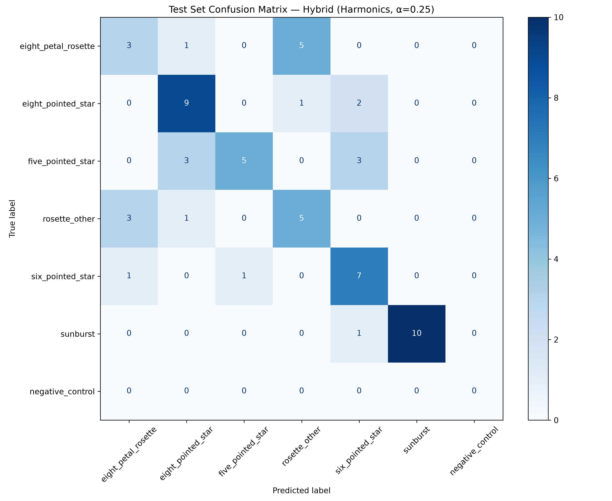

# v0.2 — Final Held-Out Test Evaluation

## 1. Objective and Evaluation Protocol

Evaluate the generalization of the development-selected retrieval and classification configurations on the held-out test set, alongside predefined baselines.

**Development-selected configurations:**

- **Retrieval candidate:** `exp03_pointedness`, α=0.25 — selected based on Hit@1, Hit@5, and MRR.
- **Classification candidate:** `exp01_harmonics`, α=0.25, Weighted K=7 — selected based on cross-validated Macro F1.

**Evaluation setup:**

| Property | Value |
|---|---|
| Split | Stratified artifact-grouped 80/20 |
| Development / Test artifacts | 251 / 63 |
| Gallery | 287 valid development crops |
| Test queries | 61 crops across six target classes |
| Negative controls | Included in gallery; excluded from test queries |
| Feature scaling | StandardScaler fitted on development gallery only |

Two development `sunburst` crops failed feature extraction and were excluded from the gallery. Development and test partitions contain disjoint artifact IDs.

Macro F1 is computed over the six target classes. `negative_control` remains an eligible predicted class but is excluded from Macro F1 averaging because it has no test queries.

## 2. Held-Out Performance

All four configurations were evaluated on the same held-out test set.

| Configuration | Hit@1 | Hit@5 | MRR | Accuracy | Macro F1 |
|---|---:|---:|---:|---:|---:|
| DINOv2-only, α=0, Majority K=3 | **0.6885** | **0.9344** | **0.7943** | 0.6230 | 0.6133 |
| Original Hybrid, α=0.25, Weighted K=7 | 0.6066 | 0.9180 | 0.7486 | 0.5902 | 0.5801 |
| **Harmonics, α=0.25, Weighted K=7** | 0.6230 | 0.9180 | 0.7493 | **0.6393** | **0.6240** |
| Pointedness, α=0.25, Top-1 | 0.6230 | 0.9180 | 0.7552 | 0.6230 | 0.6014 |

### 2.1 Retrieval

**DINOv2-only achieves the strongest retrieval performance** across Hit@1, Hit@5, and MRR.

The development-selected `exp03_pointedness` configuration does not outperform DINOv2-only on the held-out set. Although Pointedness slightly improves MRR over Harmonics, neither geometric configuration improves overall retrieval ranking over DINOv2-only.

### 2.2 Classification

**Harmonics with Weighted K=7 achieves the highest held-out classification Macro F1 (0.6240).**

Compared with:

- **Original Hybrid:** +0.0492 Accuracy and +0.0440 Macro F1.
- **DINOv2-only:** +0.0164 Accuracy and +0.0108 Macro F1.

Harmonics correctly classifies 39/61 queries, compared with 38/61 for DINOv2-only and 36/61 for the original hybrid baseline.

The improvement over the original hybrid baseline supports the contribution of the harmonics descriptor under the same hybrid weight and voting strategy. However, the advantage over DINOv2-only is small.

## 3. Per-Class Analysis

### 3.1 Per-Class F1

| Class | DINOv2-only | Original Hybrid | Harmonics | Δ vs. DINOv2 |
|---|---:|---:|---:|---:|
| eight_petal_rosette | 0.4211 | 0.3333 | 0.3750 | −0.0461 |
| eight_pointed_star | 0.7143 | 0.6923 | 0.6923 | −0.0220 |
| five_pointed_star | 0.6000 | 0.5882 | 0.5882 | −0.0118 |
| rosette_other | 0.4706 | 0.4211 | 0.5000 | +0.0294 |
| six_pointed_star | 0.6316 | 0.5455 | 0.6364 | +0.0048 |
| sunburst | 0.8421 | 0.9000 | **0.9524** | **+0.1103** |

### 3.2 Confusion Patterns

The Harmonics configuration exhibits three notable patterns:

- **Sunburst:** Strongest class-specific performance, with 10/11 correct predictions.
- **Eight-pointed star:** 9/12 correct predictions; DINOv2-only achieves slightly higher F1 for this central pilot class.
- **Related rosettes and star variants:** Persistent confusion between `eight_petal_rosette` and `rosette_other`, and among five-, six-, and eight-pointed stars.

No positive test query was classified as `negative_control`.

**Assessment:** Harmonics provides class-dependent improvements rather than uniformly better discrimination. In particular, performance on the central `eight_pointed_star` class remains a limitation.

## 4. Final Assessment and Limitations

### 4.1 Development vs. Held-Out

The development-selected Harmonics classification configuration achieved:

- **Development CV Macro F1:** 0.6463 ± 0.0413
- **Held-out Macro F1:** 0.6240
- **Difference:** −0.0223

The held-out result is reasonably close to the development CV mean, although the two estimates use different evaluation protocols and are not directly equivalent.

### 4.2 Conclusions

**Retrieval:** DINOv2-only (α=0) achieves the strongest held-out retrieval performance among the evaluated configurations. The development-selected Pointedness candidate does not improve on it.

**Classification:** The development-selected Harmonics configuration (α=0.25, Weighted K=7) achieves the highest held-out Macro F1 (0.6240), with a modest advantage over DINOv2-only.

The results support evaluating retrieval ranking and motif classification as distinct objectives. They also show that combining geometric descriptors does not necessarily outperform simpler representations.

### 4.3 Limitations and Next Steps

- **Limited test size:** Only 61 target-class queries, with as few as nine examples per class.
- **Uncertain significance:** Performance differences have not been established as statistically significant.
- **Uneven class performance:** Rosette discrimination and the central eight-pointed-star class remain areas for improvement.
- **Limited parameter search:** Voting was evaluated at α ∈ {0, 0.25}; higher hybrid weights were not explored.
- **Negative Query Rejection:** Not yet evaluated. A separate experiment should use negative controls as queries, with rejection thresholds calibrated exclusively on development data.

The frozen Harmonics configuration is retained as the evaluated **v0.2 classification baseline**. Held-out results will not be used for retrospective parameter tuning.

Future work should focus on negative query rejection and qualitative analysis of motif confusion patterns, using a new evaluation protocol for subsequent model improvements.

## 5. Robustness Evaluation
## Robustness Evaluation

The frozen v0.2 retrieval and classification configurations were additionally evaluated under synthetic image degradations using artifact-disjoint 5-fold cross-validation on the development split.

The Hybrid approach showed better clean-image classification performance but greater sensitivity to degradation, particularly strong blur.

See [v0.2 Robustness Evaluation](../v0.2_robustness/evaluation.md) for methodology, results, and limitations.
